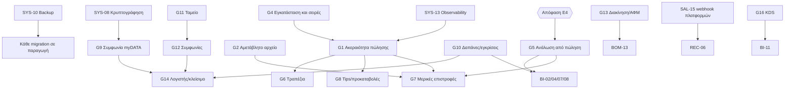

# 04 · Roadmap υλοποίησης

Προτεινόμενη σειρά για τα κενά του `02-feature-gap-matrix.md`, με τις προδιαγραφές του `03-detailed-functional-spec.md` (ομάδες G1–G17). **Δεν ξεκινά υλοποίηση πριν εγκριθεί.** Οι εκτιμήσεις είναι σε ημέρες developer, χωρίς χρόνο αναμονής για απαντήσεις Viva/λογιστή. Δεν δίνονται ημερομηνίες ολοκλήρωσης.

## 1. Executive summary: οι 10 σημαντικότερες ελλείψεις

| # | Έλλειψη | IDs | Γιατί μετρά |
|-|-|-|-|
| 1 | Κανένα αυτόματο backup και καμία δοκιμή επαναφοράς | SYS-10 | Απώλεια του server = απώλεια φορολογικών και εμπορικών δεδομένων |
| 2 | Τα φορολογικά μπορούν να αλλάξουν ή να σβηστούν, και το κλείσιμο επιχείρησης τα σβήνει | FIS-10, SYS-09, SYS-18 | Νόμιμη διατήρηση παραστατικών |
| 3 | Η κατάσταση «άγνωστο» δεν λύνεται αυτόματα με ερώτημα στη Viva, και η `Sale` δεν έχει κλειδί idempotency | FIS-11, FIS-12, FIS-13, FIS-07 | Κίνδυνος διπλής χρέωσης/έκδοσης ή χαμένης απόδειξης |
| 4 | Μυστικά (κλειδιά myDATA, Viva, πλατφορμών) αποθηκεύονται καθαρά | SYS-08 | Διαρροή βάσης = πρόσβαση σε λογαριασμούς ΑΑΔΕ/Viva |
| 5 | Η πώληση δεν κινεί απόθεμα | BOM-06, BOM-03, BI-02, BI-08 | Χωρίς αυτό δεν βγαίνουν food cost, variance και σωστό P&L |
| 6 | Καμία συμφωνία myDATA (τι λείπει, τι περισσεύει) και κανένας ορισμένος υπεύθυνος ανά ροή | MYD-08, MYD-09, MYD-10, MYD-01 | Διπλή ή χαμένη υποβολή, ευθύνη λογιστή/επιχείρησης |
| 7 | Χωρίς observability και χωρίς tests απομόνωσης tenants | SYS-13, SYS-01, SYS-14 | Αποτυχίες διαβίβασης περνούν απαρατήρητες· διαρροή μεταξύ πελατών χωρίς δίχτυ |
| 8 | Συμφωνία Viva/τράπεζας/πλατφορμών χωρίς πραγματικά δεδομένα Viva και χωρίς εκκαθαρίσεις πλατφορμών | REC-01, REC-02, REC-03, REC-06, REC-07 | Το 2.400/24/2.376 δεν ελέγχεται, τα delivery δεν συμφωνούν |
| 9 | Δαπάνες χωρίς εγκρίσεις, περίοδο, κέντρα κόστους και λήξη | EXP-02…07, ORG-04 | Διοικητικό P&L λάθος μήνα και χωρίς έλεγχο |
| 10 | Λογιστής: χωρίς batches, κλείδωμα περιόδου και mapping | ACC-08, ACC-09, ACC-06, ACC-01 | Διπλό import και αλλαγές μετά το κλείσιμο |

## 2. P0 blockers και P1 core

### P0 blockers (πριν από ευρεία παραγωγική χρήση)

| ID(s) | Θέμα | Ομάδα | Effort |
|-|-|-|-|
| SYS-10 | Backup και δοκιμή επαναφοράς | G3 | M |
| SYS-08 | Κρυπτογράφηση μυστικών | G3 | S |
| FIS-10, SYS-09, SYS-18 | Αμετάβλητο φορολογικό αρχείο, διατήρηση | G2 | M |
| FIS-11, FIS-12, FIS-13, FIS-07, FIS-16, FIS-17, SYS-11 | Ακεραιότητα πώλησης/διαβίβασης | G1 | M–L |
| ORG-02, ORG-06, FIS-01, FIS-03 | Εγκατάσταση ΑΑΔΕ, ΑΑ σειρών, onboarding, δοκιμές χονδρικής | G4 | S–M |
| SYS-13 | Logs και ειδοποιήσεις αποτυχιών | G3 | M |
| SYS-01, SYS-14 | Tenant isolation tests, E2E | G3 | M–L |
| SAL-08, FIS-05 | Ταυτόχρονο split, ανοιχτά 8.6 στο κλείσιμο | G6 | S |
| FIS-09 | Tips (μετά από Q4) | G8 | M |
| MYD-08, MYD-09, MYD-10, MYD-02 | Συμφωνία myDATA, υπεύθυνος ροής | G9 | M |
| INV-13, INV-09 | Μεταφορές μεταξύ ΑΦΜ, σκοπός διακίνησης | G13 | S–M |
| FIN-08, FIN-13 | Ένα κλείσιμο ταμείου, αντιλογισμοί | G11 | S–M |
| ACC-08, ACC-01 | Export batches, ρόλος λογιστή | G14 | M |
| EXP-08 | Επαλήθευση ότι δεν υπάρχει διπλομέτρηση | G10 | S |
| SYS-05, SYS-16, SYS-07 | Επιτρεπτές μεταβάσεις, drift, κάλυψη audit | — | S–M |

Το INV-10 (ψηφιακή παραλαβή) είναι P0, αλλά ξεκινά με μελέτη της Α.1233/2026. Ο κώδικας μπαίνει όταν οριστεί τι ισχύει για το μοντέλο της επιχείρησης.

### P1 core

| Ομάδα | IDs |
|-|-|
| G5 Ανάλωση από πώληση | BOM-06, BOM-03, BOM-07, SAL-10, BI-02, BI-08 |
| G6/G7 Τραπέζια και επιστροφές | SAL-04, SAL-09, FIS-06 |
| G8 Προκαταβολές | SAL-12, FIN-03, FIS-08 |
| G10 Δαπάνες | EXP-01…07, ORG-04, PUR-05 |
| G11 Ταμείο | FIN-09, FIN-12 |
| G12 Συμφωνίες | REC-01…08 |
| G13 Διακίνηση | INV-05, BOM-13 |
| G14 Λογιστής | ACC-06, ACC-07, ACC-09, ACC-11, ACC-02, ACC-03 |
| G15 Τιμές | CAT-05, CAT-06, ORG-08 |
| G16 KDS | SAL-05, SAL-06 |
| G17 Aging | CRM-02, CRM-03, PUR-11, FIN-07, FIN-10 |
| Μικρά | PUR-09 (ολοκλήρωση), CAT-02, CAT-04, CAT-09, MYD-01, MYD-04, MYD-05, MYD-07, INV-02, INV-04, INV-06, BOM-05, SAL-07, ACC-10, HR-04, BI-01, BI-03, BI-04, BI-06, BI-07, BI-09, BI-12, SYS-12, SYS-15, SYS-17 |

## 3. Εξαρτήσεις

## 4. Φάσεις

| Φάση | Περιεχόμενο | Ομάδες | Effort (ημ.) | Προϋποθέσεις |
|-|-|-|-|-|
| **0 · Ολοκλήρωση τρέχουσας δουλειάς** | Commit των επιστροφών/πιστωτικών προμηθευτή (PUR-09) μετά από έλεγχο σε browser· διόρθωση drift· δοκιμή 1.1/2.1/5.1/9.3 στο demo | — | 2–3 | — |
| **1 · Ακεραιότητα και συμμόρφωση** | Backup, κρυπτογράφηση, αμετάβλητο αρχείο, idempotency πώλησης, άγνωστη κατάσταση, εγκατάσταση ΑΑΔΕ, σειρές, observability, tenant tests, test matrix | G3, G2, G4, G1 | 20–30 | Ε3, Ε5, Ε6, Q1, Q2 |
| **2 · Εμπορικός πυρήνας** | Ανάλωση από πώληση, τραπέζια, μερικές επιστροφές, tips/προκαταβολές, τιμές/εκπτώσεις, aging, KDS | G5, G6, G7, G8, G15, G17, G16 | 31–43 | Ε4, Q3–Q6, Φάση 1 (G1) |
| **3 · Συμφωνίες** | Ταμείο/βάρδιες, Viva/τράπεζα/πλατφόρμες, συμφωνία myDATA | G11, G12, G9 | 23–30 | Q8, εξουσιοδοτημένα API πλατφορμών |
| **4 · Αποθήκη και παραγωγή** | Μεταφορές με παραλαβή, διαφορετικά ΑΦΜ, σκοπός διακίνησης, FEFO, φύρες, yield | G13 + μικρά INV/BOM | 10–15 | Q7, μελέτη Α.1233 |
| **5 · Λογιστής** | Δαπάνες/εγκρίσεις/κέντρα κόστους, ρόλος λογιστή, mapping, batches, κλείσιμο μήνα | G10, G14 | 16–20 | Q9, Q10, Φάσεις 3 |
| **6 · BI** | Food cost, P&L με σωστή περίοδο, variance, prime cost, drill-down, alerts | μικρά BI | 10–15 | Φάσεις 2 και 5 |
| **7 · Προαιρετικά** | Loyalty, πάγια, παρουσίες/ΕΡΓΑΝΗ, ερωτήσεις AI, anomaly detection, franchise | CRM-04, AST, HR-03/05, AI-02/04, ORG-09 | 20–30 | — |

## 5. Backlog (epics και tasks)

| Epic | Task | IDs | Acceptance criterion (σύντομα) | Effort | Προϋποθέσεις |
|-|-|-|-|-|-|
| E0 Τρέχουσα δουλειά | Έλεγχος οθονών επιστροφής/πιστωτικού σε browser, commit | PUR-09 | Επιστροφή 9.3 και πιστωτικό myDATA μειώνουν το ανοιχτό υπόλοιπο | S | — |
| E0 | Διόρθωση drift defaults `FiscalAttempt`/`FiscalDocument` | SYS-16 | `prisma migrate diff` κενό | XS | — |
| E1 Ασφάλεια | pg_dump κρυπτογραφημένο, διατήρηση, μηνιαία δοκιμή επαναφοράς | SYS-10 | Επαναφορά σε προσωρινή βάση περνά τον έλεγχο πλήθους | M | Ε3 |
| E1 | AES-GCM στα μυστικά με σταδιακή μετάβαση | SYS-08 | Κανένα μυστικό καθαρό στο dump | S | Ε6 |
| E1 | JSON logs, correlation id, alerts αποτυχιών | SYS-13 | 3 αποτυχίες/10′ → ειδοποίηση | M | — |
| E1 | Tenant isolation suite σε όλα τα routes/jobs/exports | SYS-01 | Κάθε cross-tenant id → 404 | M | — |
| E1 | Playwright για 5 βασικές ροές στο CI | SYS-14 | Πράσινο στο CI | M | — |
| E2 Αρχείο | Trigger αμεταβλητότητας, `Restrict`, διατήρηση στο κλείσιμο | FIS-10, SYS-09, SYS-18 | UPDATE σε SIGNED απορρίπτεται | M | Ε5, Q9 |
| E3 Πώληση | `Sale.clientKey`, enum `UNKNOWN/REJECTED/CANCELLED` | FIS-11, FIS-12 | Ίδιο κλειδί → ίδια πώληση | S | — |
| E3 | `resolveUnknown` στο cron με ερώτημα Viva | FIS-13 | UNKNOWN → SIGNED/REJECTED χωρίς διπλή έκδοση | M | Q1 |
| E3 | Android 1.2–1.7 (methodId, clientKey, SecureStore, 202/502) | FIS-07, SYS-11 | Διακοπή δικτύου στη μέση δεν δημιουργεί διπλό | M | Q2, νέο APK |
| E3 | `apiVersion`/`provider` στο `FiscalDocument` | FIS-17 | Κάθε νέο έγγραφο έχει έκδοση | XS | — |
| E3 | `docs/fiscal-test-matrix.md` + tests σεναρίων | FIS-16 | Ένα test ανά σενάριο της μήτρας | M | — |
| E4 Εκδότης | `Store.aadeBranch`, ενιαία κατανομή ΑΑ, checklist onboarding | ORG-02, ORG-06, FIS-01 | Ταυτόχρονες εκδόσεις → διαδοχικοί ΑΑ | S | — |
| E5 Ανάλωση | Σύνδεση προϊόντος/modifier με ανάλωση | BOM-06, BOM-03 | 1 πώληση → σωστές κινήσεις | L | Ε4 |
| E5 | Κέρασμα/προσωπικό | SAL-10 | Τιμή 0, ανάλωση, αιτία | S | Q6 |
| E5 | Αναφορά variance | BOM-07, BI-08 | Θεωρητικό vs απογραφή ανά είδος | S | E5 |
| E6 Τραπέζια | Move/merge/split με ιστορικό | SAL-04 | Γραμμές και γύροι μεταφέρονται | M | Q3 |
| E6 | Ανοιχτά 8.6 στο κλείσιμο ημέρας, test ταυτόχρονου settle | FIS-05, SAL-08 | Προειδοποίηση με λίστα | S | — |
| E7 Επιστροφές | Μερική επιστροφή με έγκριση | SAL-09, FIS-06 | Δεύτερη επιστροφή ίδιας γραμμής απορρίπτεται | M | E3 |
| E8 Tips/προκαταβολές | Tip, deposit, ετεροχρονισμένη πληρωμή | FIS-09, SAL-12, FIS-08 | Tip εκτός πωλήσεων | M | Q4, Q5 |
| E9 Τιμές | Κανάλι/κατάστημα στον τιμοκατάλογο, ΦΠΑ με ισχύ, εκπτώσεις | CAT-05, ORG-08, CAT-06 | Παλιές αποδείξεις κρατούν τον παλιό ΦΠΑ | M | — |
| E10 Ταμείο | Ένα κλείσιμο, cash drop, έγκριση διαφοράς, κλειστά kinds, αντιλογισμός | FIN-08, FIN-09, FIN-12, FIN-13 | Διαφορά πάνω από όριο ζητά έγκριση | M | — |
| E11 Συμφωνίες | Εισαγωγή συναλλαγών Viva, εκκαθαρίσεις, payout ως μεταφορά | REC-01, REC-02, REC-03 | Σενάριο 2.400/24/2.376 περνά | L | πρόσβαση Data Services |
| E11 | Ομαδική αντιστοίχιση, αναίρεση, οθόνη εξαιρέσεων | REC-05, REC-07, REC-08 | Αναίρεση αφήνει ιστορικό | M | — |
| E11 | Webhook πλατφορμών (inbox) και εκκαθαρίσεις | SAL-15, REC-06 | Διπλό webhook → μία παραγγελία | L | API πλατφορμών |
| E12 myDATA | Σελιδοποίηση και checkpoints λήψης, dedup αριθμού | MYD-01, MYD-02 | 2 σελίδες → όλα, χωρίς διπλά | S | — |
| E12 | Αναφορά διαφορών εισερχομένων/εξερχομένων, υπεύθυνος ροής | MYD-08, MYD-09, MYD-10 | Τιμολόγιο χωρίς καταχώριση φαίνεται | M | Q8 |
| E12 | Προτεινόμενοι χαρακτηρισμοί με έγκριση λογιστή | MYD-07 | Μόνο πρόταση, όχι αυτόματη αποστολή | M | Q8 |
| E13 Διακίνηση | Στάδια μεταφοράς, έλεγχος ΑΦΜ, σκοπός διακίνησης | INV-05, INV-13, INV-09 | Μεταφορά σε άλλο ΑΦΜ μπλοκάρεται | M | Q7 |
| E13 | Μελέτη Α.1233/2026 και design ψηφιακής παραλαβής | INV-10 | Εγκεκριμένο design | S (μελέτη) | — |
| E14 Δαπάνες | Πεδία, κατηγορίες, κέντρα κόστους, επιμερισμός, επαναλαμβανόμενες | EXP-01…04, EXP-06, EXP-07, ORG-04 | Ενοίκιο 50/50 στον σωστό μήνα | M | — |
| E14 | Κοινός μηχανισμός εγκρίσεων | EXP-05, PUR-05, INV-03, INV-08 | Ο ίδιος δεν εγκρίνει δικό του | M | — |
| E15 Λογιστής | Ρόλος, mapping, ExportBatch, adapter | ACC-01, ACC-06, ACC-07, ACC-08 | Δεύτερο export χωρίς διπλά | L | Q10 |
| E15 | PeriodLock και checklist κλεισίματος | ACC-09, ACC-11 | Εγγραφή σε κλειστό μήνα απορρίπτεται | M | E11, E12 |
| E16 KDS | Οθόνη κουζίνας, stations, εκτυπώσεις με αντίγραφο | SAL-05, SAL-06 | Είδη πάνε στο σωστό station | L | — |
| E17 Aging | Λήξεις, aging, όριο πίστωσης | CRM-02, CRM-03, PUR-11, FIN-07, FIN-10 | Υπέρβαση ορίου ζητά έγκριση | M | — |
| E18 BI | P&L περιόδου, food/prime cost, drill-down, alerts | BI-02, BI-04, BI-06, BI-07, BI-12, BI-13 | Κάθε κάρτα ανοίγει τα παραστατικά της | L | E5, E14 |

## 6. Release plan

1. **Ένα PR ανά task**, πάνω στο `master`, με το δικό του test. Τα P0 μπαίνουν πρώτα στο demo, μετά σε ένα κατάστημα (Πειραιάς), μετά παντού.
2. **Migrations**: μόνο προσθετικά (νέες nullable στήλες, νέες τιμές enum, νέοι πίνακες, ευρετήρια).
   - Οι αλλαγές συμπεριφοράς πίσω από ρύθμιση ανά tenant όπου αγγίζουν ταμείο (π.χ. ανάλωση από πώληση, κλείδωμα περιόδου).
   - Το trigger αμεταβλητότητας μπαίνει μετά από έλεγχο ότι κανένα υπάρχον SIGNED δεν χρειάζεται διόρθωση.
3. **Android**: οι αλλαγές API μόνο μεγαλώνουν το συμβόλαιο (νέα προαιρετικά πεδία), ώστε το παλιό APK να δουλεύει μέχρι να αλλάξει σε όλα τα ταμεία.
4. **Sandbox/demo certification checks** πριν από κάθε φορολογική αλλαγή:
   - Μήτρα σεναρίων (FIS-16): λιανική, 8.6 με 2 γύρους, split κάρτα+μετρητά, επιστροφή πλήρης/μερική, timeout, διπλό αίτημα, offline, 1.1/2.1/5.1/9.3, tips.
   - Αποτελέσματα με MARK σε `docs/fiscal-test-matrix.md`.
   - Υπογραφή από λογιστή για τα σενάρια Q3–Q8.
5. **Rollback**:
   - Κάθε release έχει backup ακριβώς πριν από το migrate (μετά το E1).
   - Τα προσθετικά migrations δεν χρειάζονται down: η προηγούμενη έκδοση της εφαρμογής δουλεύει με το νέο schema.
   - Οι αλλαγές συμπεριφοράς κλείνουν από τη ρύθμιση του tenant.
   - Φορολογικά έγγραφα που εκδόθηκαν δεν αναιρούνται με rollback: μόνο με πιστωτικό/ακυρωτικό.
6. **Testing ανά φάση**: unit για κανόνες, integration σε βάση `_test` για κάθε ροή με χρήματα/στοκ, Playwright για τις οθόνες που αλλάζουν, έλεγχος desktop και κινητού.

## 7. Τι ΔΕΝ ξαναγράφεται

Λειτουργούν και καλύπτονται από tests ή δοκιμή σε demo. Επεκτείνονται, δεν αντικαθίστανται:

- **Ταμείο**: λιανική web/Android, τραπέζια και γύροι, modifiers, κρατήσεις, παραγγελίες τηλεφώνου, βάρδιες ταμία.
- **Φορολογικά**: Viva receipts:sign, 8.6, 11.4, `lib/mydata-aade.ts` (ΑΑΔΕ απευθείας), `fiscal-retry`, ουρά offline.
- **Αγορές**: παραγγελία → παραλαβή → τιμολόγιο → three-way match, MRP, RFQ, OCR, λήψη από myDATA.
- **Αποθήκη**: καθολικό, παρτίδες, απογραφές (και offline), μεταφορές, διορθώσεις, μέσο κόστος, ιχνηλασιμότητα.
- **Παραγωγή**: συνταγές με έλεγχο κύκλων και εκδόσεις, παρτίδες, πλάνα, κλείσιμο ημέρας, πρόβλεψη, HACCP.
- **Χονδρική**: προσφορές, παραγγελίες, παραστατικά, εισπράξεις, πύλη B2B, δρομολόγια.
- **Χρήματα**: λογαριασμοί, κινήσεις, μεταφορές, κατανομές πληρωμών, εισαγωγή τράπεζας, πληρωμές μισθοδοσίας.
- **Οριζόντια**: CRM/Party 360, GDPR, audit log, δικαιώματα, συνδρομές SaaS, υποστήριξη/KB, μετάπτωση, VIES, τηλεφωνία.

## 8. Συνολικό effort

| Μέρος | Ημέρες developer |
|-|-|
| Ομάδες G1–G17 (03-detailed-functional-spec) | 97–133 |
| Μικρά κενά εκτός ομάδων (P1/P2) | 25–40 |
| Φάση 7 (προαιρετικά) | 20–30 |
| **Σύνολο χωρίς τη Φάση 7** | **~120–175** |
| **Σύνολο με τη Φάση 7** | **~140–205** |

**Υποθέσεις**:
- Ένας developer που ξέρει τον κώδικα, με τα κοινά (εγκρίσεις, inbox, batches) μετρημένα μία φορά.
- Δεν περιλαμβάνεται ο χρόνος αναμονής απαντήσεων Viva/λογιστή/ΑΑΔΕ, η διανομή APK, ούτε η ψηφιακή παραλαβή INV-10 πέρα από τη μελέτη.

**Κίνδυνοι που μεγαλώνουν το εύρος**:
- Απαντήσεις Viva που αλλάζουν τη ροή άγνωστης κατάστασης ή offline.
- Υποχρεώσεις της Α.1233/2026.
- Ποιότητα των αρχείων τραπεζών και πλατφορμών.
