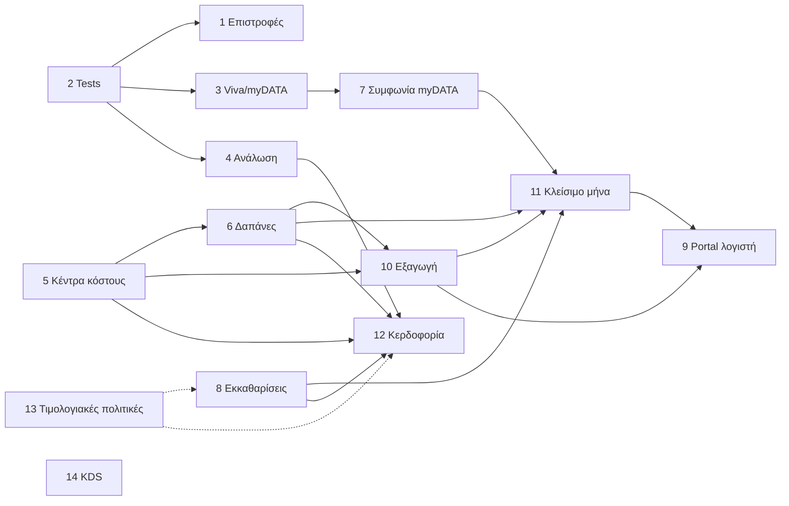
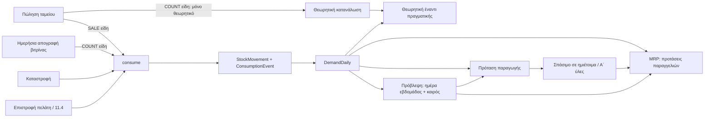

# 05 · Στοχευμένος οδικός χάρτης: 14 ενότητες

Συνέχεια των `01`–`04`, με βάση τον κώδικα στο commit `905bb4f` (28/11/2026). **Κανένας κώδικας δεν αλλάζει πριν εγκριθεί αυτό το έγγραφο.**

Σταθερά για όλες τις ενότητες:
- PostgreSQL, Prisma, Next.js. Κάθε επιχείρηση έχει δικό της `orgId` σε κάθε πίνακα. Τα ποσά είναι πάντα ακέραια λεπτά (`*Cents`), το κόστος σε εκατοστά του λεπτού (`*Hundredths`).
- Τα υπάρχοντα modules δεν ξαναχτίζονται. Επεκτείνονται.
- **Εκτός πεδίου:** γενική λογιστική (καθολικό, ημερολόγιο, ισοζύγιο), νόμιμα βιβλία, φορολογικές δηλώσεις, υπολογισμός μισθοδοσίας. Η εφαρμογή παράγει δεδομένα για τον λογιστή, δεν κάνει λογιστική.
- Κάθε νέα οθόνη ακολουθεί τους κανόνες UI: απλά ελληνικά, χρώμα με νόημα, γράφημα στο αποτέλεσμα, desktop και κινητό χωρίς δεύτερο scrollbar. Για μεγάλη αλλαγή UI, πρώτα εγκρίνεται mockup.
- Η εκτίμηση είναι σε ημέρες developer (ημ.), χωρίς τον χρόνο που περιμένουμε απαντήσεις από Viva, ΑΑΔΕ ή λογιστή.

## Επαλήθευση: χρησιμοποιείται το RequestMyIncome;

**Όχι.** Υπάρχει μόνο σε σχόλια (`lib/mydata-income.ts:49`, `lib/mydata-receipts.ts:2`).

| Ροή | Endpoint ΑΑΔΕ | Κώδικας |
|-|-|-|
| Μεμονωμένα τιμολόγια προμηθευτών προς εμάς | `RequestDocs` (με `continuationToken`) | `lib/mydata-income.ts:24`, `lib/mydata-incoming.ts`, `lib/mydata-check.ts`, parser `lib/mydata-parse.ts` |
| Δικά μας παραστατικά και αποδείξεις που διαβίβασε η Viva | `RequestTransmittedDocs`, ανά MARK | `lib/mydata-income.ts:53`, `lib/mydata-receipts.ts`, `lib/mydata-aade.ts:13` |

Η επιλογή είναι σωστή. Το `RequestMyIncome`/`RequestMyExpenses` δίνει συγκεντρωτικά ποσά ανά χαρακτηρισμό και αντισυμβαλλόμενο, όχι μεμονωμένα παραστατικά με γραμμές. Και όπως είδαμε στο sandbox (28/11), δεν περιέχει καθόλου 11.x. **Το RequestMyIncome δεν προστίθεται.** Μπορεί να μπει αργότερα μόνο ως έλεγχος συνόλων μήνα στην ενότητα 11, αν το ζητήσει ο λογιστής.

## Συνοπτική εικόνα

| # | Ενότητα | Κατάσταση | Εκτίμηση | Εξαρτάται από |
|-|-|-|-|-|
| 1 | Επιστροφές και πιστωτικά προμηθευτή | 🟢 Σταθεροποίηση | 2–3 ημ. | 2 |
| 2 | Integration tests σε PostgreSQL | 🟡 Επέκταση | 5–7 ημ. | — |
| 3 | Έλεγχος Viva Fiscal και myDATA | 🟡 Επέκταση | 5–8 ημ. | 2 |
| 4 | Μηχανή κατανάλωσης και προγραμματισμός (λογική της παλιάς εφαρμογής) | 🟡 Μεταφορά + νέο | 16–23 ημ. (+6–10 έξυπνη πρόβλεψη) | 2 |
| 5 | Κέντρα κόστους και κατανομή εξόδων | 🔴 Νέο | 5–7 ημ. | — |
| 6 | Επέκταση δαπανών (τύποι εξόδων myDATA) | 🟡 Επέκταση | 6–8 ημ. | 5 |
| 7 | Πίνακας συμφωνίας myDATA | 🟡 Επέκταση | 4–6 ημ. | 3 |
| 8 | Συμφωνία εκκαθαρίσεων Viva (πλατφόρμες αργότερα) | 🟡 Επέκταση | 4–6 ημ. | 6 |
| 9 | Portal εξωτερικού λογιστή | 🔴 Νέο | 4–6 ημ. | 10, 11 |
| 10 | Μηχανή εξαγωγής (γενική, πρώτα SoftOne) | 🟡 Επέκταση | 7–9 ημ. | 5, 6 |
| 11 | Μηνιαίο εμπορικό κλείσιμο | 🔴 Νέο | 5–7 ημ. | 6, 7, 8, 10 |
| 12 | Διοικητική λογιστική και κερδοφορία καταστήματος | 🟡 Επέκταση | 6–9 ημ. | 4, 5, 6, 8 |
| 13 | Τιμολογιακές πολιτικές πελάτη | 🟡 Επέκταση | 5–7 ημ. | — |
| 14 | Οθόνη κουζίνας (KDS) | 🟢 Ολοκλήρωση | 3–5 ημ. | — |
| | **Σύνολο** | | **83–121 ημ.** | |



### Προτεινόμενη σειρά

| Φάση | Ενότητες | Εκτίμηση | Γιατί με αυτή τη σειρά |
|-|-|-|-|
| A · Σταθεροποίηση | 2 → 1 → 3 | 12–18 ημ. | Δίχτυ ασφαλείας πριν αγγίξουμε φορολογικές ροές |
| B · Θεμέλια κόστους | 5 → 6, 4α + 4α΄ (παράλληλα) | 27–38 ημ. | Χωρίς αυτά δεν βγαίνει σωστό κόστος ούτε σωστό μηνιαίο αποτέλεσμα |
| C · Συμφωνίες | 7, 8 (μόνο Viva) | 8–12 ημ. | Χρειάζονται πριν το κλείσιμο μήνα |
| D · Λογιστής | 10 → 11 → 9 | 16–22 ημ. | Μια παρτίδα εξαγωγής ανήκει σε κλειστή περίοδο. Το portal δείχνει ό,τι έχει κλείσει |
| E · Διοίκηση | 12 | 6–9 ημ. | Ενώνει όλα τα προηγούμενα |
| F · Έξυπνη πρόβλεψη | 4β | 6–10 ημ. | Θέλει τουλάχιστον 8 εβδομάδες πραγματικής κατανάλωσης και το πορτοφόλι tokens |
| Παράλληλα, όποτε υπάρχει χρόνος | 13, 14 | 8–12 ημ. | Δεν εξαρτώνται από τίποτα |

### Αποφάσεις (απαντήσεις ιδιοκτήτη, 28/11/2026)

| Κωδ. | Ερώτημα | Απόφαση | Επηρεάζει |
|-|-|-|-|
| Ε4 | Τρόπος ανάλωσης | **Συνάρτηση κατανάλωσης με πρότυπες συνταγές.** Η πώληση «σπάει» σε υλικά και τα βγάζει από την αποθήκη. Για τις γεύσεις στη βιτρίνα η κατανάλωση μετριέται, όπως στην παλιά εφαρμογή, από την ημερήσια απογραφή (§4.0–4.2). Το ίδιο ισχύει για καταστροφές και για επιστροφές από πελάτη (αντίστροφη κίνηση). Η κατανάλωση που καταγράφεται τροφοδοτεί προγραμματισμό παραγωγής, προτάσεις παραγγελιών και εργαλείο προβλέψεων | 4, 12 |
| Q8 | Ποιος χαρακτηρίζει τα έξοδα στο myDATA | **Ο λογιστής ανοίγει τύπους εξόδων και λογαριασμούς. Το ίδιο μπορούμε να κάνουμε κι εμείς.** Για το demo, φορτώνουμε προεπιλογές με βάση τους επίσημους χαρακτηρισμούς myDATA της ΑΑΔΕ. Το ίδιο ισχύει για τα κέντρα κόστους | 5, 6, 7, 10 |
| Q9 | Χρόνια διατήρησης φορολογικών | Ανοιχτό. Το απαντά ο λογιστής | 11 |
| Q10 | Πρόγραμμα του λογιστή | **Πρώτος adapter για SoftOne, η μηχανή όμως γενική.** Ένα ουδέτερο μοντέλο εξαγωγής με adapter ανά πρόγραμμα | 10 |
| Q11 | Αρχεία εκκαθάρισης Wolt/efood | **Αναβάλλεται.** Η ενότητα 8 ξεκινά μόνο με Viva και τράπεζα | 8 |
| Q12 | Τιμές ανά κανάλι | **Τιμολογιακές πολιτικές ανά πελάτη, βάσει συμφωνίας.** Εφαρμόζονται αυτόματα στα παραστατικά όταν αγοράζει. Η ενότητα 13 ξαναγράφτηκε | 13 |

---

## 1 · Επιστροφές και πιστωτικά προμηθευτή (PUR-09)

**Υπάρχει σήμερα**
- Μπήκε σε commit στο `056d1de`: `lib/purchase-returns.ts`, `lib/purchase-returns-rules.ts`, `app/(app)/purchases/[id]/adjustments.tsx`, migration `20261128090000_purchase_returns_credits`.
- Το `PurchaseDoc` έχει `relatedId`, `returnId`, `fiscalDocumentId` (το δικό μας 9.3 «Επιστροφή»), `mydataType` (1.1/5.1/5.2), `relatedMark`, `stockMode` (`returned`/`now`/`value`) και `creditCents`. Το `PurchaseLine.sourceLineId` ορίζει το όριο ποσότητας.
- Η κίνηση αποθέματος γίνεται με `postStockMovement`. Unit tests: `purchase-returns.test.ts`.

**Κενά**
- Κανένα integration test σε PostgreSQL. Δεν έχει δοκιμαστεί η σύγκρουση δύο ταυτόχρονων επιστροφών στην ίδια γραμμή.
- Δεν έχει ελεγχθεί σε browser (desktop και κινητό).
- Η πρόταση σύνδεσης ενός πιστωτικού από το myDATA (`relatedMark`) με το αρχικό τιμολόγιο δεν έχει δοκιμαστεί με πραγματικά δεδομένα από το `MydataIncoming`.
- Δεν είναι σαφές πώς φαίνεται το 5.2 (συμψηφιστικό) στο υπόλοιπο του προμηθευτή (`SupplierPayment`).

**Επιχειρηματικές απαιτήσεις**
- Επιστροφή εμπορεύματος: μειώνει το απόθεμα, εκδίδει 9.3 και περιμένει πιστωτικό.
- Πιστωτικό προμηθευτή: μειώνει την οφειλή μας. Αν δεν προηγήθηκε επιστροφή, ο χρήστης επιλέγει αν το απόθεμα επιστρέφεται τώρα ή αν το πιστωτικό αφορά μόνο αξία.
- Το υπόλοιπο προμηθευτή = τιμολόγια − πιστωτικά − πληρωμές.

**Αλλαγές στο Prisma**
- Κανένα νέο μοντέλο.
- Αν δεν υπάρχει ήδη, `@@index([orgId, relatedId])` στο `PurchaseDoc`.
- Αν στην παραγωγή επιτρέπονται μόνο συγκεκριμένες τιμές, έλεγχος (CHECK) για `stockMode IN (...)`.

**Υπάρχοντα services που ξαναχρησιμοποιούνται:** `postStockMovement`, `lockStockKey` (`lib/stock-db.ts`), η έκδοση 9.3 μέσω `issuerForStore`, `lib/mydata-incoming-match.ts`.

**APIs και UI**
- Κανένα νέο. Στην οθόνη του προμηθευτή, γραμμή «Πιστωτικά που περιμένουμε», δηλαδή επιστροφές χωρίς πιστωτικό.

**Κανόνες και οριακές περιπτώσεις**
- Η ποσότητα που επιστρέφεται δεν ξεπερνά την ποσότητα της αρχικής γραμμής μείον όσα έχουν ήδη επιστραφεί, με κλείδωμα της γραμμής.
- Το πιστωτικό δεν ξεπερνά το υπόλοιπο του τιμολογίου (`creditCents ≤ totalCents`).
- Επιστροφή από παρτίδα που έχει ήδη καταναλωθεί → σφάλμα με το διαθέσιμο υπόλοιπο της παρτίδας.
- Αν η διαβίβαση του 9.3 αποτύχει, η επιστροφή μένει σε «εκκρεμεί διαβίβαση» και δεν σβήνεται.
- Αν ακυρωθεί πιστωτικό που κλείνει επιστροφή, η επιστροφή ξανανοίγει.

**Κριτήρια αποδοχής**
- Τιμολόγιο 10 τεμ. → επιστροφή 4 → πιστωτικό για 4: απόθεμα −4, οφειλή −αξία των 4, ένα 9.3 με MARK.
- Δύο ταυτόχρονες επιστροφές 4+4 σε γραμμή 6 τεμ.: η μία περνά και η άλλη παίρνει σαφές μήνυμα.
- Πιστωτικό μόνο αξίας (`value`): το απόθεμα δεν αλλάζει.

**Integration tests** (`lib/purchase-returns.integration.ts`): μερική επιστροφή, υπέρβαση ορίου, ταυτόχρονες επιστροφές, πιστωτικό με `stockMode=now`, ακύρωση πιστωτικού, απομόνωση από ξένο `orgId`.

**Εξαρτήσεις:** ενότητα 2 (υποδομή tests). **Εκτίμηση:** 2–3 ημ.

---

## 2 · Integration tests σε PostgreSQL (SYS-01, SYS-14)

**Υπάρχει σήμερα**
- 25 αρχεία `lib/*.integration.ts`: stock, procurement, production, wholesale, finance, billing, POS API, reports, staff, migration.
- `npm run test:integration` με `scripts/assert-test-db.mjs`, που αρνείται να τρέξει σε βάση που δεν είναι δοκιμαστική.
- 699 unit tests περνούν (28/11).

**Κενά**
- Δεν υπάρχουν integration tests για: επιστροφές και πιστωτικά, myDATA (εισερχόμενα, έλεγχος αποδείξεων), `FiscalDocument` (έκδοση, επανάληψη, 11.4), πώληση στο POS μέχρι το `Sale` και το `Payment`, κλείσιμο ταμείου.
- Δεν υπάρχει γενικό test απομόνωσης: «κάθε query με `orgId` A δεν βλέπει δεδομένα της B».
- Δεν υπάρχει CI που να τρέχει τα integration tests σε ξεχωριστή PostgreSQL. Τα tests δεν έτρεξαν σε αυτόν τον έλεγχο.
- Δεν υπάρχουν κοινά fixtures: κάθε αρχείο στήνει μόνο του την επιχείρηση.

**Επιχειρηματικές απαιτήσεις:** καμία αλλαγή στα φορολογικά και στο απόθεμα δεν μπαίνει σε commit χωρίς integration test που περνά.

**Αλλαγές στο Prisma:** καμία.

**Υπάρχοντα services που ξαναχρησιμοποιούνται:** `assert-test-db.mjs`, το στήσιμο του `demo-seed.integration.ts`, το `Dockerfile`.

**APIs, UI και υποδομή**
- `lib/test/fixtures.ts`: `createOrg()`, `createStore()`, `createSupplier()`, `createProduct()`. Ένα helper, όχι framework.
- Mock για Viva και ΑΑΔΕ με τις υπάρχουσες απαντήσεις από `lib/viva/fixtures`.
- `docker compose` με PostgreSQL για τα tests, συν ένα job CI.

**Κανόνες και οριακές περιπτώσεις**
- Τα tests τρέχουν σειριακά (`--test-concurrency=1`, όπως σήμερα), εκτός από εκείνα που ελέγχουν σκόπιμα ταυτόχρονες συναλλαγές.
- Κάθε test καθαρίζει το δικό του `orgId` (cascade). Κανένα `TRUNCATE` σε όλη τη βάση.

**Κριτήρια αποδοχής**
- `npm run test:integration` περνά τοπικά και στο CI.
- Υπάρχουν tests για επιστροφές, myDATA, fiscal, πώληση POS και απομόνωση.
- Test σε κάθε server action ανάγνωσης/εγγραφής των ενοτήτων 1–14: ένας χρήστης της A με `id` εγγραφής της B παίρνει 404.

**Integration tests:** `tenant-isolation.integration.ts`, `fiscal.integration.ts`, `mydata.integration.ts`, `pos-sale.integration.ts`, `cash-closing.integration.ts`.

**Εξαρτήσεις:** καμία, ξεκινά πρώτο. **Εκτίμηση:** 5–7 ημ. (fixtures και CI 2, τα πέντε νέα αρχεία 3–5).

---

## 3 · Έλεγχος Viva Fiscal και myDATA (FIS-01, FIS-07, FIS-11…13)

**Υπάρχει σήμερα**
- `lib/viva/fiscal.ts`, `sign.ts`, `sandbox-contract.test.ts`, `scripts/viva-sandbox-contract.ts`.
- `FiscalDocument` με `receiptReference @unique`, `mark`, `aa`, `totalCents`, `relatedId` (5.1/11.4), `FiscalAttempt`, `lib/fiscal-retry*.ts`, `/api/cron/fiscal`.
- Έλεγχος ανά MARK με `RequestTransmittedDocs` στο sandbox (28/11). Διόρθωση `totalCents`/`aa` στα 11.4, με backfill.
- Εκδότης ανά κατάστημα (`LegalEntity`, `issuerForStore`), κλειδιά myDATA ανά κατάστημα (`lib/mydata-keys.ts`).

**Κενά**
- Το 1.1, το 5.1 και το 9.3 δεν έχουν δοκιμαστεί από άκρη σε άκρη μέσω ISV στο demo.
- Η κατάσταση «άγνωστο» δεν λύνεται αυτόματα με ερώτημα στη Viva (FIS-11…13).
- Η `Sale` δεν έχει κλειδί idempotency: διπλό tap από τη συσκευή μπορεί να δημιουργήσει δύο πωλήσεις (FIS-07).
- Τρία MARK 11.1 στο sandbox δεν έχουν αντίστοιχο `FiscalDocument` (είναι εκτός της βάσης μας, άρα δεν είναι δικά μας).
- Η ρύθμιση `aadeBranch` (υποκατάστημα ΑΑΔΕ) εκκρεμεί.

**Επιχειρηματικές απαιτήσεις**
- Κάθε πληρωμένη πώληση έχει ακριβώς ένα παραστατικό με MARK.
- Κάθε MARK της ΑΑΔΕ με το ΑΦΜ μας αντιστοιχεί σε ένα δικό μας παραστατικό.
- Χωρίς διπλή χρέωση, χωρίς χαμένη απόδειξη.

**Αλλαγές στο Prisma**
- `Sale.clientRef String?` με `@@unique([deviceId, clientRef])`. Το κλειδί το παράγει η συσκευή μία φορά ανά καλάθι.
- `FiscalDocument.resolvedAt DateTime?` και `resolution String?` (`viva_lookup` | `aade_mark` | `manual`).
- `Store.aadeBranch Int @default(0)`, αν δεν υπάρχει ήδη στο `LegalEntity`.

**Υπάρχοντα services που ξαναχρησιμοποιούνται:** `lib/fiscal-retry.ts`, `lib/mydata-receipts-match.ts`, `lib/mydata-aade.ts`, `/api/cron/fiscal`, `TaskRun` με `steps`.

**APIs και UI**
- `POST /api/pos/sales`: δέχεται `clientRef`. Αν το ξαναστείλει η συσκευή, παίρνει την ίδια πώληση πίσω.
- Μέσα στο `cron/fiscal`: για κάθε «άγνωστο», ερώτημα στη Viva με `receiptReference`, ύστερα αναζήτηση MARK στην ΑΑΔΕ.
- Στην οθόνη «Διαβιβάσεις»: φίλτρο «Άγνωστη κατάσταση» και κουμπί «Έλεγξε τώρα».

**Κανόνες και οριακές περιπτώσεις**
- Μετά από timeout, ποτέ νέα χρέωση. Πρώτα ερώτημα.
- Αν η Viva λέει «υπογράφηκε» και η ΑΑΔΕ δεν έχει MARK ύστερα από 24 ώρες → ειδοποίηση, όχι επανάληψη.
- Ένα 11.4 χωρίς `relatedId` απορρίπτεται πριν σταλεί.
- Το 5.1 συνδέεται μόνο με 1.1 του ίδιου πελάτη.

**Κριτήρια αποδοχής**
- Στο demo: 1.1, 2.1, 5.1 και 9.3 εκδίδονται, παίρνουν MARK και ταιριάζουν στο `RequestTransmittedDocs`.
- Η ίδια πώληση με το ίδιο `clientRef` στέλνεται 2 φορές → 1 `Sale`, 1 `Payment`.
- Ένα «άγνωστο» λύνεται μόνο του μέσα σε έναν κύκλο cron.

**Integration tests** (`fiscal.integration.ts`, με mock Viva/ΑΑΔΕ): idempotency, timeout → άγνωστο → επίλυση, 11.4 χωρίς σχετικό, 5.1 σε λάθος πελάτη, retry χωρίς διπλή εγγραφή.

**Εξαρτήσεις:** ενότητα 2, πρόσβαση ISV στο demo της Viva. **Εκτίμηση:** 5–8 ημ.

---

## 4 · Μηχανή κατανάλωσης και προγραμματισμός από την κατανάλωση (BOM-06, BOM-03, SAL-10, INV-06)

**Απόφαση Ε4:** μία **συνάρτηση κατανάλωσης** με πρότυπες συνταγές. Ό,τι φεύγει από το κατάστημα σπάει σε υλικά και βγαίνει από την αποθήκη: πώληση, κέρασμα, καταστροφή. Ό,τι επιστρέφει κάνει την αντίστροφη κίνηση: επιστροφή από πελάτη, ακύρωση. Η καταγεγραμμένη κατανάλωση τροφοδοτεί προγραμματισμό παραγωγής, προτάσεις παραγγελιών και προβλέψεις.

### 4.0 Πώς το κάνει η παλιά εφαρμογή (`web/.reference/gelatosystem/gelatosystem-app-main`)

Η παλιά εφαρμογή **δεν** παίρνει τη ζήτηση από τις πωλήσεις του ταμείου, γιατί δεν είχε ταμείο. Τη βγάζει από την **ημερήσια απογραφή βιτρίνας**:

```
κατανάλωση (= πωλήσεις) ημέρας = προηγούμενη καταμέτρηση + εισαγωγές από εργαστήριο − σημερινή καταμέτρηση − πεταμένα
```

Οι πηγές στον κώδικα:
- Υπολογισμός: migration `0012_atomic_shop_count.sql`, στη στήλη `stock_count_items.consumption_qty`.
- Τα πεταμένα: από το `0050` γράφονται χωριστά (`waste_qty`, κίνηση φύρας).

Πάνω σε αυτή τη χρονοσειρά, ανά γεύση και κατάστημα, χτίζονται τα εξής:

| Αρχείο (παλιά) | Τι κάνει |
|-|-|
| `src/lib/gelato/plan-suggest.ts` | **Πρόταση παραγωγής ημέρας.** Για κάθε γεύση: μέσος όρος κατανάλωσης ανά ημέρα εβδομάδας για τις ημέρες ως την επόμενη παραγωγή, + ελάχιστο βιτρίνας, − απόθεμα καταστήματος, + χονδρική, − έτοιμο απόθεμα εργαστηρίου, − ό,τι είναι ήδη προγραμματισμένο. Το αποτέλεσμα στρογγυλοποιείται σε ολόκληρες καραπίνες, και το μίγμα = έτοιμο ÷ (1 − κανονική φύρα). Οι ημέρες που η γεύση **τελείωσε** μετρούν ως «λογοκριμένη» ζήτηση: max(πωλήσεις, μέσος όρος των ημερών χωρίς εξάντληση) |
| `mrp-demand.ts` | Από τις προγραμματισμένες παρτίδες στη ζήτηση Α΄ υλών. Αφαιρεί πρώτα το απόθεμα ημιέτοιμων (βάσεις) και πιστώνει την προγραμματισμένη παραγωγή ημιέτοιμων πριν σπάσουν οι παρτίδες που τα χρησιμοποιούν, με τοπολογική σειρά, ώστε να μη μετρηθούν διπλά |
| `mrp.ts` (1.477 γρ.) | **MRP βάσει κατανάλωσης.** Απόθεμα ασφαλείας που μαθαίνεται από την κατανάλωση 28 ημερών (z·σ·√(L+R)). Χρόνος παράδοσης από το ιστορικό του προμηθευτή (διάμεσος, ≥3 παραγγελίες σε 180 ημέρες). Ημέρες παράδοσης και παραγγελίας. Στρογγυλοποίηση σε συσκευασίες. Ζήτηση/ημέρα = max(βέβαιη ζήτηση από παρτίδες και χονδρική, μέση κατανάλωση × συντελεστής ημέρας) + απώλειες. **Σποραδικά υλικά** (`0062`) με διάμεσο χρήσης αντί για μέσο όρο. Μέσο σταθμικό κόστος (`0049`) |
| `weather-forecast.ts` + `0088` | **Πρόβλεψη με καιρό:** ζήτηση = βάση × συντελεστής ημέρας × (1+β)^θερμοκρασία πάνω από 20 °C × (1+γ αν βρέχει). Τα β και γ μαθαίνονται με παλινδρόμηση ανά κατάστημα, με συρρίκνωση προς προεπιλογές. Πάροχος MET Norway. Αποθηκεύει την πρόβλεψη της παραμονής και την πραγματική κατανάλωση, ώστε να μετρά την ακρίβεια (MAPE, `mrp-accuracy.ts`) |
| `shop-analysis.ts` | Ανάλυση βιτρίνας: γεύσεις που κάθονται, στέλνονται περισσότερο απ' όσο φεύγουν, αρνητική κατανάλωση (λάθος μέτρησης), κίνδυνος φύρας |
| `flavour-profit.ts` | Κερδοφορία ανά γεύση: food cost/kg από τη σύνθεση ÷ πραγματική απόδοση, μερίδα = g × €/kg + συσκευασία, και συνεισφορά = κιλά από τις απογραφές × καθαρή τιμή/kg |

**Η σύνδεση παραγωγής και πωλήσεων στην παλιά εφαρμογή:** απογραφή βιτρίνας → κατανάλωση ανά γεύση → πρόταση παραγωγής → παρτίδες → σπάσιμο σε ημιέτοιμα και Α΄ ύλες → MRP → πρόταση παραγγελίας. Το κλείσιμο ημέρας παραγωγής γράφει τις αναλώσεις (`production_consumption`, `0007`/`0072`).

### 4.1 Τι έχει περάσει στη νέα εφαρμογή

| Παλιά | Νέα | Κατάσταση |
|-|-|-|
| Κλείσιμο ημέρας παραγωγής με διάδοση ζήτησης και σειρά | `lib/production-day-close.ts` (+ integration test) | ✅ Πέρασε |
| Απογραφή καταστήματος | `StockCount`/`StockCountLine` (`expectedQty`, `actualQty`, `differenceQty`) | ⚠️ Η διαφορά γράφεται ως **διόρθωση**, όχι ως κατανάλωση/πωλήσεις. Δεν υπάρχει `waste_qty` ούτε `consumption_qty` |
| MRP v2 | `mrpSuggestion` (`lib/procurement.ts:26`), `/orders/mrp`, πεδία `MrpItemSetting` (mode, leadDays, coverDays, orderDays, deliveryDays) | ⚠️ Απλοποιημένο: μέση ημερήσια χρήση από **όλες** τις αρνητικές κινήσεις, χωρίς μάθηση ασφαλείας, συντελεστή ημέρας, σποραδικά ή χρόνο παράδοσης από ιστορικό |
| Πρόταση παραγωγής (`plan-suggest`) | `lib/forecast.ts` (ιστορικό 28 → 7 ημέρες) | ⚠️ Χωρίς ημέρα εβδομάδας, λογοκριμένες ημέρες, ελάχιστο βιτρίνας, καραπίνες ή φύρα |
| Πρόβλεψη με καιρό, ακρίβεια | — | ❌ Δεν πέρασε |
| Ανάλυση βιτρίνας, κερδοφορία γεύσης | `recipe-analysis.ts` (κόστος σύνθεσης) | ❌ Η ανάλυση δεν πέρασε |
| Κατανάλωση από πώληση ταμείου | — | ❌ Δεν υπήρχε ούτε στην παλιά, γιατί δεν είχε ταμείο |

### 4.2 Η πρόταση: δύο πηγές κατανάλωσης, μία συνάρτηση

Το παγωτό χύμα **δεν** μετριέται σωστά από την απόδειξη: μια «μπάλα» δεν είναι πάντα 70 g. Γι' αυτό η απογραφή βιτρίνας δούλευε σωστά και πρέπει να μείνει η κύρια πηγή για τις γεύσεις. Τα μετρήσιμα είδη αναλώνονται από την πώληση: κύπελλα, χωνάκια, ποτά, καφές, κρέπα, συσκευασμένα. Κάθε είδος (`GenericItem`) δηλώνει την πηγή του:

| `consumptionSource` | Παράδειγμα | Πότε γράφεται η κίνηση | Τι δίνει η άλλη πηγή |
|-|-|-|-|
| `COUNT` | Γεύσεις στη βιτρίνα, σε kg | Στην οριστικοποίηση της ημερήσιας απογραφής: προηγούμενη + εισαγωγές − καταμέτρηση − πεταμένα = κατανάλωση | Οι πωλήσεις ταμείου × πρότυπη μερίδα = **θεωρητική** κατανάλωση. Η διαφορά είναι «υπερμερίδα» ή διαφορά μέτρησης |
| `SALE` | Κύπελλο, χωνάκι, κουτάλι, αναψυκτικό, γάλα στον καφέ | Στην έκδοση της πώλησης, με σπάσιμο της πρότυπης συνταγής πώλησης | Η απογραφή δίνει **διαφορά** απέναντι στο θεωρητικό, που γράφεται ως διόρθωση με αιτία |

Και οι δύο δρόμοι περνούν από την ίδια `consume()`, γράφουν `ConsumptionEvent` και ενημερώνουν την ίδια ημερήσια ζήτηση (`DemandDaily`), ώστε η πρόταση παραγωγής, το MRP και η πρόβλεψη να διαβάζουν **μία** χρονοσειρά.



**Κενά, συνολικά**
- Η πώληση στο POS δεν γράφει καμία κίνηση αποθέματος.
- Η απογραφή καταστήματος γράφει διόρθωση, όχι κατανάλωση. Τα πεταμένα δεν ξεχωρίζουν.
- Δεν υπάρχει πρότυπη συνταγή **πώλησης** (μερίδα), μόνο συνταγή παραγωγής ανά δόση.
- Δεν υπάρχει καταστροφή με αιτία, ούτε επιστροφή από πελάτη.
- Η πρόταση παραγωγής, το MRP και η πρόβλεψη είναι απλοποιημένες σε σχέση με την παλιά εφαρμογή (πίνακας 4.1).

**Επιχειρηματικές απαιτήσεις**
1. Μία `consume()` για όλα τα γεγονότα:
   - `SALE`, `TREAT` (κέρασμα), `STAFF` (προσωπικό)
   - `WASTE` (καταστροφή, με αιτία: λήξη, σπάσιμο, ποιότητα, HACCP)
   - `COUNT_CONSUMPTION` (από απογραφή βιτρίνας)
   - `CUSTOMER_RETURN` (ξαναμπαίνει στο απόθεμα **ή** καταστρέφεται)
   - `VOID` (11.4)
2. Σπάσιμο σε επίπεδα: αν το ημιέτοιμο έχει απόθεμα, καταναλώνεται αυτό. Αν είναι «φτιάχνεται τη στιγμή» (`madeToOrder`), σπάει στη συνταγή του. Αυτός είναι ο ίδιος κανόνας με το `mrp-demand.ts` και το `production-day-close.ts`.
3. Η ημερήσια απογραφή βιτρίνας γράφει **κατανάλωση** και **πεταμένα** χωριστά, όπως στην παλιά (`consumption_qty`, `waste_qty`), και όχι μία διόρθωση.
4. Μεταφορά της λογικής της παλιάς εφαρμογής, **ως καθαρές συναρτήσεις με τα tests τους**, πάνω στο `DemandDaily`:
   - `plan-suggest` → `lib/planning/production-suggest.ts`: ημέρα εβδομάδας, λογοκριμένες ημέρες, ελάχιστο βιτρίνας, καραπίνες, κανονική φύρα, χονδρική
   - `mrp.ts` → επέκταση του `mrpSuggestion`: μάθηση αποθέματος ασφαλείας, χρόνος παράδοσης από ιστορικό, συντελεστής ημέρας, σποραδικά υλικά, συσκευασίες
   - `weather-forecast.ts` + `mrp-accuracy.ts` → `lib/planning/weather-forecast.ts`: μοντέλο καιρού και μέτρηση ακρίβειας
   - `shop-analysis.ts`, `flavour-profit.ts` → αναφορές (ενότητα 12)
5. **Έξυπνη πρόβλεψη (4β):** πάνω από το εξηγήσιμο μοντέλο καιρού, προαιρετικό μοντέλο AI (εποχικότητα, αργίες, εκδηλώσεις). Χρεώνεται με tokens από το πορτοφόλι του συνδρομητή, και ο χρήστης βλέπει πάντα και την εξηγήσιμη πρόβλεψη δίπλα, με την ακρίβεια (MAPE) της καθεμίας.

**Αλλαγές στο Prisma**
```prisma
model SalesRecipe {               // πρότυπη συνταγή πώλησης: τι καταναλώνει 1 τεμάχιο
  id               String   @id @default(cuid())
  orgId            String
  productId        String?           // προϊόν POS
  modifierOptionId String?           // ή επιλογή (topping, μέγεθος)
  version          Int      @default(1)
  validFrom        DateTime @default(now())
  lines            SalesRecipeLine[]
  @@unique([productId, version])
  @@unique([modifierOptionId, version])
}
model SalesRecipeLine {
  id            String @id @default(cuid())
  orgId         String
  salesRecipeId String
  genericItemId String
  quantityBase  Int              // βασική μονάδα· αρνητικό στις επιλογές = λιγότερο
  @@index([orgId, genericItemId])
}
model ConsumptionEvent {
  id            String   @id @default(cuid())
  orgId         String
  storeId       String
  warehouseId   String
  kind          String   // SALE | TREAT | STAFF | WASTE | COUNT_CONSUMPTION | CUSTOMER_RETURN | VOID
  reason        String?  // καταστροφή: EXPIRED | BROKEN | QUALITY | HACCP | OTHER
  restock       Boolean  @default(false)
  saleLineId    String?  @unique   // idempotency πώλησης
  countLineId   String?  @unique   // idempotency απογραφής
  productId     String?
  quantity      Int
  occurredAt    DateTime
  status        String   @default("POSTED") // POSTED | NEEDS_REVIEW
  createdByName String?
  @@index([orgId, warehouseId, occurredAt])
}
model DemandDaily {                // μία χρονοσειρά για παραγωγή, MRP, πρόβλεψη
  orgId           String
  warehouseId     String
  genericItemId   String
  day             DateTime @db.Date
  consumedBase    Int               // πραγματική (απογραφή ή πώληση)
  theoreticalBase Int      @default(0) // πωλήσεις × πρότυπη μερίδα (για COUNT είδη)
  wasteBase       Int      @default(0)
  stockedOut      Boolean  @default(false) // καταμέτρηση 0: λογοκριμένη ζήτηση
  @@id([orgId, warehouseId, genericItemId, day])
}
model WeatherDaily { orgId String; locationKey String; day DateTime @db.Date; tMaxC10 Int; rainMm10 Int; source String; @@id([orgId, locationKey, day]) }
model DemandForecast {             // πρόβλεψη της παραμονής + πραγματική → ακρίβεια
  orgId String; warehouseId String; genericItemId String; day DateTime @db.Date
  model String                     // BASELINE | WEATHER | AI
  forecastBase Int; actualBase Int?
  @@id([orgId, warehouseId, genericItemId, day, model])
}
```
- `GenericItem`: `consumptionSource String @default("SALE")` (`SALE | COUNT`), `madeToOrder Boolean @default(false)`, `perishable Boolean @default(false)`, `minDisplayBase Int?` (ελάχιστο βιτρίνας).
- `StockCountLine`: `wasteQty Int @default(0)`, `consumptionQty Int?`, `inflowQty Int @default(0)`.
- `StockMovement.consumptionEventId String?`, και νέες τιμές του `source`: `consumption`, `waste`, `customer_return`.
- `SaleLine.kind String @default("SALE")`: κέρασμα και προσωπικό με τιμή 0, που δεν πάνε στη Viva.
- `Recipe` (παραγωγή): `machineCapacityGrams Int?` (καραπίνα) και `normalWastePct Int?`, αν δεν υπάρχουν.
- Οι θερμοκρασίες αποθηκεύονται ως ακέραιοι ×10 (`tMaxC10`), σύμφωνα με τον κανόνα των ακεραίων.

**Υπάρχοντα services που ξαναχρησιμοποιούνται**
- Νέα εφαρμογή: `postStockMovement`, `lockStockKey`, `resolveWarehouseId`, `lotBalances` (FEFO), `production-day-close.ts` (σπάσιμο και σειρά), `recipe-graph.ts`, `stock-counts` (οριστικοποίηση), `mrpSuggestion`, `roundedOrderQuantity`, `nextAllowedDay`, `MrpItemSetting`, `ProductionPlan`, `PurchaseOrder`/`Rfq`, `calculateForecast` (γίνεται το «BASELINE»), `TaskRun`, `UsageEvent`/`UsagePrice`.
- Παλιά εφαρμογή: η **λογική και τα tests** των `plan-suggest`, `mrp`, `mrp-demand`, `weather-forecast`, `mrp-accuracy`, `shop-analysis` και `flavour-profit`, ξαναγραμμένα σε ακέραιους (η παλιά δούλευε με δεκαδικά). Τα tests της παλιάς γίνονται fixtures για να επιβεβαιωθεί ότι τα αποτελέσματα είναι ίδια.

**APIs και UI**
- `lib/consumption.ts`: `consume(tx, event)`. Σπάσιμο με όριο βάθους 5 και ανίχνευση κύκλου, κινήσεις, `DemandDaily`.
- Καλείται από:
  - την έκδοση πώλησης (μόνο για τα είδη `SALE`, ενώ για τα `COUNT` γράφεται μόνο το `theoreticalBase`)
  - την οριστικοποίηση απογραφής βιτρίνας (`COUNT`)
  - το 11.4
  - την οθόνη καταστροφών
  - την επιστροφή πελάτη
- Καρτέλα προϊόντος: «Πρότυπη συνταγή πώλησης» με κόστος μερίδας και περιθώριο. Καρτέλα είδους: «Πώς μετράται η κατανάλωση» (πώληση ή απογραφή).
- Απογραφή βιτρίνας (tablet): «Μετρήθηκε» και «Πετάχτηκε/έληξε» ανά γεύση, όπως στην παλιά.
- POS και tablet: «Καταστροφή» και «Επιστροφή από πελάτη».
- Οθόνη «Προγραμματισμός» (αύριο / 7 ημέρες): τι να παραχθεί (σε καραπίνες) και τι να παραγγελθεί, με εξήγηση ανά γραμμή, πρόβλεψη με και χωρίς καιρό, και κουμπιά «Φτιάξε πλάνο παραγωγής» και «Φτιάξε παραγγελία».
- Αναφορές:
  - θεωρητική έναντι πραγματικής (υπερμερίδα σε g και €)
  - καταστροφές ανά αιτία
  - ακρίβεια πρόβλεψης
  - ανάλυση βιτρίνας (γεύσεις που κάθονται, αρνητική κατανάλωση)
- Cron: καιρός δύο φορές την ημέρα. Η πρόβλεψη της παραμονής αποθηκεύεται στο `DemandForecast`.

**Κανόνες και οριακές περιπτώσεις**
- **Η αποτυχία κατανάλωσης δεν μπλοκάρει ποτέ την πώληση.** Αν το απόθεμα βγει αρνητικό, η κίνηση γράφεται ως `NEEDS_REVIEW`. Προϊόν χωρίς συνταγή → `NEEDS_REVIEW`, και εμφανίζεται στη λίστα «Προϊόντα χωρίς συνταγή».
- Ένα είδος `COUNT` **ποτέ** δεν καταναλώνεται και από την πώληση και από την απογραφή, γιατί έτσι θα μετρούσε διπλά.
- Η ημέρα με εξάντληση (καταμέτρηση 0) είναι λογοκριμένη: μετρά ως max(πωλήσεις, μέσος όρος ημερών χωρίς εξάντληση), όπως στην παλιά.
- Αρνητική κατανάλωση από απογραφή (εισαγωγή που δεν καταχωρήθηκε) → `NEEDS_REVIEW` και εξαιρείται από την πρόβλεψη.
- Απογραφή που λείπει για μια ημέρα: η επόμενη απογραφή καλύπτει όλο το διάστημα, και η κατανάλωση μοιράζεται στις ημέρες με βάρη από τις πωλήσεις του ταμείου (αν υπάρχουν), αλλιώς ισόποσα.
- Idempotency: `saleLineId`/`countLineId @unique`. Η διόρθωση οριστικοποιημένης απογραφής ξαναγράφει τις κινήσεις της, όπως το `correct_shop_count` της παλιάς.
- Η συνταγή που ισχύει είναι εκείνη της ημερομηνίας του γεγονότος (`version`/`validFrom`).
- Το 11.4 κάνει αντιλογισμό με τις ίδιες ποσότητες και το **ίδιο** κόστος με την αρχική κατανάλωση.
- Η επιστροφή πελάτη με `restock = false` γράφει είσοδο και ταυτόχρονα καταστροφή, ώστε να φαίνεται στη φύρα.
- Η καταστροφή πάνω από ένα όριο αξίας θέλει έγκριση.
- Η χονδρική κινεί ήδη απόθεμα. Δεν περνά από τη `consume`, γράφει όμως στο `DemandDaily`. Στην πρόβλεψη μετρά μία φορά: η επιβεβαιωμένη χονδρική προστίθεται ως βέβαιη ζήτηση και η ιστορική εξαιρείται, όπως κάνει η παλιά.
- Κύκλος σε συνταγή → απόρριψη στην αποθήκευση.
- Οι ημέρες κλειστού καταστήματος (`StorePause`) εξαιρούνται από το ιστορικό.
- Στο μοντέλο καιρού, λίγα δεδομένα (< 60 ημέρες) → «εκτίμηση», με συντελεστή καιρού 1 όταν λείπει ο καιρός, όπως στην παλιά.

**Κριτήρια αποδοχής**
- Γεύση φράουλα (`COUNT`): χθες 4,0 kg, εισαγωγή 5,0 kg, σήμερα 3,2 kg, πεταμένα 0,3 kg → κατανάλωση 5,5 kg και φύρα 0,3 kg, σε δύο κινήσεις.
- Την ίδια ημέρα, 70 μπάλες στο ταμείο × 70 g = 4,9 kg θεωρητική κατανάλωση, οπότε η αναφορά δείχνει υπερμερίδα 0,6 kg (12%) σε € και %.
- Κύπελλο 2 μπάλες + topping (`SALE` είδη) → κύπελλο −1, κουτάλι −1, σάλτσα −20 g, με κόστος. Η γεύση δεν κινείται στην πώληση.
- Κρέπα (`madeToOrder`) → σπάει σε αλεύρι, γάλα, αυγά, βούτυρο.
- 11.4 → αντίθετες κινήσεις με το ίδιο κόστος.
- Με τα fixtures της παλιάς εφαρμογής, η πρόταση παραγωγής και το MRP της νέας δίνουν τα ίδια αποτελέσματα (με ανοχή στρογγυλοποίησης στη βασική μονάδα).
- Η πρόβλεψη με καιρό αποθηκεύεται την παραμονή, και η ακρίβεια (MAPE) εμφανίζεται μετά την απογραφή της ημέρας.

**Integration tests** (`consumption.integration.ts`, `planning.integration.ts`):
- Σπάσιμο: με modifiers, πολλά επίπεδα και κύκλος.
- Χωρίς διπλή μέτρηση: `COUNT` χωρίς διπλή κατανάλωση, χονδρική χωρίς διπλή ζήτηση.
- Απογραφή: με πεταμένα, χωρίς απογραφή μιας ημέρας, διόρθωση οριστικοποιημένης.
- Επιστροφές: idempotency, 11.4 με ιστορικό κόστος, επιστροφή με και χωρίς επανεισαγωγή.
- Λογοκριμένη ζήτηση, αρνητικό χωρίς μπλοκάρισμα, FEFO.
- Πρόταση παραγωγής και MRP απέναντι στα fixtures της παλιάς.
- Ξένος `orgId`.

**Εξαρτήσεις:** ενότητα 2. Χρειάζεται mockup για τη συνταγή πώλησης, την απογραφή με πεταμένα και τον προγραμματισμό. Η 4β χρειάζεται το πορτοφόλι tokens.
**Εκτίμηση:**
- 4α, κατανάλωση (πώληση + απογραφή), καταστροφές, επιστροφές, θεωρητική έναντι πραγματικής: 10–14 ημ.
- 4α΄, μεταφορά πρότασης παραγωγής, MRP v2 και πρόβλεψης με καιρό από την παλιά: 6–9 ημ.
- 4β, έξυπνη πρόβλεψη AI: 6–10 ημ., μετά από τουλάχιστον 8 εβδομάδες πραγματικών δεδομένων.

---

## 5 · Κέντρα κόστους και κατανομή εξόδων (ORG-04, EXP-05)

**Απόφαση Q8:** τα κέντρα κόστους τα ανοίγει ο λογιστής, αλλά μπορούμε κι εμείς. Για το demo έρχονται προφορτωμένα.

**Σημαντικό:** **το myDATA δεν έχει κέντρα κόστους.** Το παραστατικό και ο χαρακτηρισμός έχουν μόνο κατηγορία, τύπο, ποσά και ΦΠΑ (έλεγχος στο API v2.0.2). Τα κέντρα κόστους είναι αποκλειστικά δικά μας, διοικητικά. Η δομή τους ακολουθεί το `PRSCOSTCNTR` της SoftOne (κωδικός, σύντμηση, περιγραφή, ιεραρχία, λογαριασμός), ώστε να εξάγονται χωρίς μετάφραση.

**Υπάρχει σήμερα**
- Το `Expense.storeId` είναι προαιρετικό και το `category` ελεύθερο κείμενο.
- Το `allocateCents` (`lib/reports.ts:36`) μοιράζει ποσό σε βάρη χωρίς να χάνει λεπτά.
- `BudgetTarget`. Τα `Department` υπάρχουν για το προσωπικό.

**Κενά:** δεν υπάρχει μοντέλο κέντρου κόστους, ούτε κανόνας κατανομής κοινών εξόδων στα καταστήματα (ενοίκιο έδρας, λογιστής, εργαστήριο).

**Επιχειρηματικές απαιτήσεις**
- Κάθε έξοδο, αγορά και κίνηση λογαριασμού ανήκει σε ένα κέντρο κόστους.
- Τα κέντρα έχουν ιεραρχία (π.χ. Καταστήματα → Κατάστημα Κηφισιάς).
- Τα κοινά κέντρα κατανέμονται στα καταστήματα με κανόνα: ποσοστά, τζίρος ή τ.μ.
- Η κατανομή είναι διοικητική. Δεν αλλάζει το παραστατικό, ούτε όσα πάνε στο myDATA ή στον λογιστή.
- Τα κέντρα τα ανοίγει ο λογιστής (από το portal, ενότητα 9) ή ο ιδιοκτήτης. Κάθε κέντρο κρατά ποιος το άνοιξε.

**Προεπιλογές demo**

| Κωδικός | Κέντρο | Είδος | Γονικό | Κατανέμεται; |
|-|-|-|-|-|
| `10` | Καταστήματα | STORE | — | — |
| `10.<n>` | Ένα ανά κατάστημα (αυτόματα από το `Store`) | STORE | 10 | Όχι, τελικό |
| `20` | Εργαστήριο παραγωγής | PRODUCTION | — | Ναι, με τζίρο, στα καταστήματα |
| `30` | Διοίκηση / έδρα | HQ | — | Ναι, με τζίρο |
| `40` | Διανομή (δικά μας οχήματα) | DELIVERY | — | Ναι, με παραγγελίες delivery |
| `50` | Μάρκετινγκ | HQ | — | Ναι, ισόποσα |

**Αλλαγές στο Prisma**
```prisma
model CostCenter {
  id        String  @id @default(cuid())
  orgId     String
  code      String               // όπως PRSCOSTCNTR.CODE
  name      String
  kind      String               // STORE | PRODUCTION | HQ | DELIVERY | OTHER
  parentId  String?              // ιεραρχία (SOHCODE στη SoftOne)
  storeId   String? @unique
  accountCode String?            // προαιρετικός λογαριασμός του λογιστή
  source    String  @default("USER") // SEED | ACCOUNTANT | USER
  active    Boolean @default(true)
  @@unique([orgId, code])
}
model CostAllocationRule {
  id         String    @id @default(cuid())
  orgId      String
  sourceId   String    // το κοινό κέντρο
  basis      String    // FIXED | REVENUE | AREA | ORDERS | EQUAL
  validFrom  DateTime  @db.Date
  validTo    DateTime? @db.Date
  shares     Json      // [{costCenterId, weight}] για FIXED/AREA
  @@index([orgId, sourceId, validFrom])
}
```
- `Expense.costCenterId`, `PurchaseDoc.costCenterId` (όπως το `PURDOC.COSTCNTR`), `FinanceTransaction.costCenterId`.
- Migration: ένα `CostCenter` ανά υπάρχον `Store`. Τα υπάρχοντα έξοδα παίρνουν το κέντρο του καταστήματός τους, και όσα δεν έχουν κατάστημα πάνε στο `30`.

**Υπάρχοντα services που ξαναχρησιμοποιούνται:** `allocateCents`, `reportPeriod`, οι server actions του `finance`, η οθόνη `company`, το `lib/setup.ts` και το `store-setup` (το νέο κατάστημα παίρνει αυτόματα κέντρο).

**APIs και UI**
- `/company/cost-centers`: δέντρο κέντρων και κανόνες, με προεπισκόπηση «πώς μοιράζεται ένα ποσό 1.000 €» σε ραβδόγραμμα.
- Επιλογή κέντρου στη φόρμα δαπάνης και αγοράς. Η προεπιλογή είναι το κέντρο του καταστήματος, ή αυτό που ορίζει ο τύπος εξόδου (ενότητα 6).
- `lib/seed/cost-centers.ts`: οι προεπιλογές demo, που καλούνται στο στήσιμο νέας επιχείρησης και στο demo seed.

**Κανόνες και οριακές περιπτώσεις**
- Τα βάρη FIXED αθροίζουν σε 100%. Αλλιώς, η αποθήκευση απορρίπτεται.
- Κανόνες με επικαλυπτόμενες περιόδους για το ίδιο κέντρο απορρίπτονται.
- REVENUE με μηδενικό τζίρο σε όλα τα καταστήματα → ίσα μερίδια, με προειδοποίηση.
- Κέντρο με κινήσεις δεν σβήνεται. Μόνο απενεργοποιείται.
- Κύκλος στην ιεραρχία → απόρριψη.

**Κριτήρια αποδοχής**
- Νέα επιχείρηση demo με 3 καταστήματα → 8 κέντρα (5 + 3 καταστήματα) και κανόνες.
- Ενοίκιο έδρας 1.000,00 € με 50/30/20 → 500,00 / 300,00 / 200,00. Το 1.000,01 € σε 3 ίσα αθροίζει ακριβώς 1.000,01.
- Νέο κατάστημα → νέο κέντρο `10.<n>` αυτόματα.

**Integration tests:** seed και επανάληψη χωρίς διπλά, migration υπαρχόντων εξόδων, κανόνας με επικάλυψη, κατανομή REVENUE, κύκλος, απομόνωση.

**Εξαρτήσεις:** καμία. **Εκτίμηση:** 5–7 ημ.

---

## 6 · Επέκταση δαπανών και τύποι εξόδων myDATA (EXP-01…07, EXP-08, MYD-07)

**Απόφαση Q8:** τους τύπους εξόδων και τους λογαριασμούς τους ανοίγει ο λογιστής, αλλά μπορούμε κι εμείς. Για το demo έρχονται προφορτωμένοι με βάση τους **επίσημους χαρακτηρισμούς myDATA της ΑΑΔΕ** (API v2.0.2, Σεπτ. 2026, και πίνακες συνδυασμών v2.0.2: βλ. Παράρτημα Α). Ο τύπος εξόδου κρατά τον χαρακτηρισμό myDATA και τον λογαριασμό, ακριβώς όπως το `EXPN` της SoftOne (`CLASSCATEGORYEX`, `CLASSTYPEX`, `ACNMSK1`, `ACNMSKVAT1`).

**Υπάρχει σήμερα**
- Το `Expense` έχει `category` (κείμενο), `netCents`, `vatCents`, `totalCents`, `informal`, `occurredAt` και `@@unique([orgId, supplierId, documentNumber])`.
- Το `createExpense` (`lib/finance-db.ts`) ελέγχει διπλό παραστατικό και καταστήματα, και γράφει `FinanceTransaction` όταν δοθεί λογαριασμός.
- Σκανάρισμα με OCR: εικόνες, ενώ PDF, νόμισμα και κατηγορία είναι σε εξέλιξη (`lib/ai/ocr.ts`, `openrouter.ts`, χωρίς commit).
- `MydataIncoming`: τα παραστατικά που δήλωσαν οι προμηθευτές για εμάς, με τύπο (1.1, 2.1, 5.1…).

**Κενά**
- Δεν υπάρχει λίστα τύπων εξόδων, ούτε χαρακτηρισμός myDATA ή λογαριασμός ανά τύπο.
- Δεν υπάρχει έλεγχος ότι ο συνδυασμός «τύπος παραστατικού + κατηγορία + τύπος Ε3» είναι επιτρεπτός. Παράδειγμα: το E3_102_002 (λιανικές) **δεν** επιτρέπεται σε 1.1.
- Λείπουν: περίοδος που αφορά η δαπάνη, λήξη, έγκριση, συνημμένο, κέντρο κόστους, επαναλαμβανόμενες δαπάνες.
- Η σύνδεση με το `MydataIncoming` λείπει: το παραστατικό είναι δαπάνη, όχι αγορά εμπορεύματος.
- Το EXP-08 (διπλομέτρηση πληρωμής και δαπάνης) δεν έχει επαληθευτεί με test.

**Επιχειρηματικές απαιτήσεις**
- Κάθε δαπάνη έχει τύπο εξόδου. Ο τύπος φέρνει αυτόματα:
  - χαρακτηρισμό myDATA (κατηγορία + τύπο Ε3 + τύπο ΦΠΑ)
  - λογαριασμό
  - προτεινόμενο κέντρο κόστους
- Ο χαρακτηρισμός εξόδων στο myDATA τον κάνει **ο λήπτης** (εμείς ή ο λογιστής), με `SendExpensesClassification` πάνω στο MARK του προμηθευτή. Ποιος τον στέλνει είναι ρύθμιση της επιχείρησης (ενότητα 7):
  - `accountant` (προεπιλογή): ο λογιστής τον στέλνει από το πρόγραμμά του και η εφαρμογή απλώς τον προτείνει και τον εξάγει
  - `erp`: η εφαρμογή τον στέλνει με έγκριση χρήστη. Αν τον στέλνει για λογαριασμό της επιχείρησης ο λογιστής, συμπληρώνεται το `entityVatNumber`
- Μια δαπάνη 3 μηνών μετρά στο αποτέλεσμα κάθε μήνα κατά το μερίδιό της.
- Δαπάνες πάνω από ένα όριο θέλουν έγκριση. Κάθε δαπάνη έχει το παραστατικό της ως αρχείο. Οι επαναλαμβανόμενες δημιουργούνται ως προσχέδια κάθε μήνα.

**Αλλαγές στο Prisma**
```prisma
model ExpenseCategory {            // «Τύπος εξόδου», αντίστοιχο του EXPN της SoftOne
  id              String  @id @default(cuid())
  orgId           String
  code            String
  name            String
  kind            String           // COGS | OPEX | PAYROLL_COST | ASSET | FINANCE | TAX_FEE | OTHER (για το P&L)
  mydataCategory  String?          // category2_x
  mydataType      String?          // E3_xxx
  mydataVatType   String?          // VAT_361…366 | NOT_VAT_295 | κενό σε απαλλαγή
  accountCode     String?          // λογαριασμός του λογιστή (πρόταση στο demo)
  vatAccountCode  String?
  costCenterId    String?          // προτεινόμενο κέντρο
  source          String  @default("USER") // SEED | ACCOUNTANT | USER
  active          Boolean @default(true)
  @@unique([orgId, code])
}
model MydataClassCombo {           // επιτρεπτοί συνδυασμοί ΑΑΔΕ, χωρίς orgId (κοινός πίνακας αναφοράς)
  docType   String   // 1.1, 2.1, 13.1, 14.30, 17.1 …
  side      String   // EXPENSE | INCOME
  category  String   // category2_x / category1_x
  type      String   // E3_xxx
  version   String   // "2.0.2"
  @@id([docType, side, category, type, version])
}
model RecurringExpense {
  id String @id @default(cuid())
  orgId String
  name String
  categoryId String
  costCenterId String?
  supplierId String?
  amountCents Int
  dayOfMonth Int
  active Boolean @default(true)
}
```
- `Expense`:
  - `categoryId String?` (το `category` κρατιέται για το migration)
  - `costCenterId`
  - `mydataDocType String?`
  - `mydataCategory`/`mydataType`/`mydataVatType` (στιγμιότυπο, αλλάζει ανά δαπάνη)
  - `classificationStatus String @default("NONE")` (`NONE | SUGGESTED | SENT | ACCEPTED | FAILED`)
  - `periodFrom`/`periodTo DateTime? @db.Date`, `dueAt DateTime?`
  - `status String @default("APPROVED")` (`DRAFT|PENDING|APPROVED|REJECTED|VOID`)
  - `approvedById`, `approvedAt`
  - `fileId String?`, `mydataIncomingId String? @unique`, `recurringId String?`
- `Organization`: `expenseApprovalCents Int?`.
- Το `MydataClassCombo` φορτώνεται από το επίσημο xlsx με script (`scripts/import-mydata-combos.ts`). Νέα έκδοση της ΑΑΔΕ = νέα `version`, χωρίς αλλαγή κώδικα.

**Υπάρχοντα services που ξαναχρησιμοποιούνται:** `createExpense`, `StoredFile` και `/api/files`, `lib/ai/ocr-scan.ts` (το OCR προτείνει τύπο εξόδου), `MydataIncoming`, `lib/mydata-aade.ts` (για `SendExpensesClassification` με `erp`), `mydata-keys.ts`, `TaskRun`, `SupplierPayment`.

**APIs και UI**
- `/company/expense-types`:
  - λίστα τύπων εξόδων, με τη στήλη «myDATA» να δείχνει κατηγορία και τύπο με την ελληνική τους περιγραφή
  - λογαριασμός και κέντρο, με ετικέτα «από λογιστή / από εμάς / προεπιλογή»
  - επιλογή κωδικού μόνο από τους επιτρεπτούς συνδυασμούς
- Η φόρμα δαπάνης παίρνει τύπο εξόδου, κέντρο, περίοδο, λήξη και συνημμένο. Το «Σκάναρε παραστατικό» τη γεμίζει. Ο χαρακτηρισμός myDATA φαίνεται με απλά λόγια: «Θα δηλωθεί ως: Ενέργεια (E3_585_011)».
- Λίστα «Περιμένουν έγκριση» (δικαίωμα `expenses.approve`).
- Στα «Τιμολόγια που λείπουν»: «Καταχώρισέ το ως δαπάνη», με προτεινόμενο τύπο από τον ΑΦΜ του προμηθευτή (ό,τι διάλεξε την προηγούμενη φορά).
- Με ρύθμιση `erp`: «Στείλε χαρακτηρισμούς στην ΑΑΔΕ», μαζικά ανά μήνα, με αποτέλεσμα ανά MARK.
- `/api/cron/recurring-expenses` (ημερήσιο).
- Γράφημα ανά τύπο εξόδου και μήνα, και λίστα «Λήγουν σε 7 ημέρες».
- `lib/seed/expense-types.ts`: οι προεπιλογές demo του Παραρτήματος Α.

**Κανόνες και οριακές περιπτώσεις**
- Συνδυασμός που δεν υπάρχει στο `MydataClassCombo` για τον τύπο παραστατικού → απόρριψη με εξήγηση. Παράδειγμα: «Το E3_102_002 δεν επιτρέπεται σε Τιμολόγιο 1.1. Διάλεξε E3_102_001».
- Ο χαρακτηρισμός ΦΠΑ είναι ξεχωριστή εγγραφή χωρίς κατηγορία (σφάλμα 315). Σε απαλλαγή ΦΠΑ δεν στέλνεται (316). Με `vatExemptionCategory` 16, μόνο VAT_366 (317).
- Σε 13.x/14.x (π.χ. λογαριασμός ρεύματος χωρίς MARK από τον πάροχο → 14.30) την καταχώριση τη διαβιβάζουμε εμείς ως λήπτης, και ο χαρακτηρισμός είναι μέσα στο παραστατικό. Αυτό γίνεται μόνο με ρύθμιση `erp`.
- Η αλλαγή τύπου εξόδου **δεν** αλλάζει δαπάνες που ήδη χαρακτηρίστηκαν (`SENT`/`ACCEPTED`).
- Η περίοδος μοιράζεται ανά ημέρα με το `allocateCents`, ώστε το άθροισμα να βγαίνει ακριβώς.
- Οι ανεπίσημες δαπάνες (`informal`) δεν εξάγονται και δεν χαρακτηρίζονται.
- Δαπάνη σε κλειστή περίοδο (ενότητα 11) δεν αλλάζει. Μόνο αντιλογισμός.
- Απορρίπτεται η σύνδεση του ίδιου `MydataIncoming` με αγορά **και** με δαπάνη.
- Η πληρωμή δαπάνης γράφει μόνο κίνηση λογαριασμού, και το P&L δεν μετρά δεύτερη φορά (EXP-08).
- Ο χρήστης δεν εγκρίνει δική του δαπάνη, εκτός αν είναι ιδιοκτήτης.
- Οι κωδικοί λογαριασμών του demo είναι **προτάσεις**. Ο λογιστής τους αλλάζει, και η αλλαγή του έχει προτεραιότητα (`source = ACCOUNTANT`).

**Κριτήρια αποδοχής**
- Νέα επιχείρηση demo → 16 τύποι εξόδων με χαρακτηρισμό myDATA και λογαριασμό (Παράρτημα Α).
- Τιμολόγιο ρεύματος 1.1 από το `MydataIncoming` → «Καταχώρισέ το ως δαπάνη» → τύπος «Ενέργεια» → category2_4 / E3_585_011 / VAT_361, κέντρο του καταστήματος.
- Επιλογή E3_102_002 σε 1.1 → απόρριψη με το μήνυμα παραπάνω.
- Ασφάλιστρο 300 € για Ιαν–Μαρ → 100 € σε κάθε μήνα στο P&L.
- Δαπάνη 600 € με όριο 500 € → «Περιμένει έγκριση».
- Με ρύθμιση `erp`, στο sandbox της ΑΑΔΕ: ο χαρακτηρισμός ενός MARK προμηθευτή γίνεται δεκτός, και ξαναδιαβάζεται με `RequestDocs`/`RequestMyExpenses` για επιβεβαίωση.

**Integration tests:** seed τύπων και κέντρων, έλεγχος συνδυασμών, κατανομή περιόδου, ροή έγκρισης, επαναλαμβανόμενη χωρίς διπλή στον ίδιο μήνα, διπλομέτρηση, κλειστή περίοδος, σύνδεση με myDATA, αποστολή χαρακτηρισμού με mock ΑΑΔΕ (επιτυχία, 315/316/317).

**Εξαρτήσεις:** ενότητα 5. Ολοκλήρωση του OCR για PDF (αλλαγές χωρίς commit). Χρειάζεται mockup. Ο λογιστής εγκρίνει τους κωδικούς του Παραρτήματος Α πριν από την πρώτη πραγματική επιχείρηση. **Εκτίμηση:** 6–8 ημ. (+2 ημ. για αποστολή χαρακτηρισμών με ρύθμιση `erp`).

---

## 7 · Πίνακας συμφωνίας myDATA (MYD-08, MYD-09, MYD-10, MYD-01, MYD-02)

**Υπάρχει σήμερα**
- `MydataIncoming` (τιμολόγια προμηθευτών από `RequestDocs`, με αντιστοίχιση σε `PurchaseDoc`).
- `MydataCheck` (έλεγχος σκαναρισμένων με ό,τι δήλωσε ο προμηθευτής).
- `MydataDayCheck` (αποδείξεις ανά ημέρα με `RequestTransmittedDocs`, ανά MARK).
- Οθόνες «Τιμολόγια που λείπουν» και «Έλεγχος με την ΑΑΔΕ», `/api/cron/mydata`, κλειδιά ανά κατάστημα, βήματα εργασίας στο `TaskRun.steps`.

**Κενά**
- Δεν υπάρχει μία οθόνη με όλη την εικόνα του μήνα: εισερχόμενα (ταιριάζουν, λείπουν από εμάς, έχουμε μόνο εμείς) και εξερχόμενα (POS, χονδρική 1.1/2.1, πιστωτικά, 9.3).
- Τα δικά μας παραστατικά χονδρικής (1.1/2.1/5.1) δεν ελέγχονται απέναντι στην ΑΑΔΕ με τον ίδιο τρόπο που ελέγχονται οι αποδείξεις.
- Δεν υπάρχει υπεύθυνος ανά ροή (MYD-02): ποιος διαβιβάζει τι (Viva, εμείς, λογιστής).
- Δεν υπάρχει ροή επίλυσης: «αγνόησε με αιτία», «ανατέθηκε σε», «λύθηκε».
- Απομένουν τα τρία 11.1 του sandbox που υπάρχουν μόνο στην ΑΑΔΕ.

**Επιχειρηματικές απαιτήσεις**
- Στο τέλος κάθε μήνα: «0 διαφορές» ή λίστα διαφορών, όπου η καθεμία έχει απόφαση.
- Ο λογιστής βλέπει την ίδια εικόνα (ενότητα 9).

**Αλλαγές στο Prisma**
```prisma
model MydataDiff {
  id         String   @id @default(cuid())
  orgId      String
  storeId    String?
  period     String   // YYYY-MM
  direction  String   // IN | OUT
  kind       String   // MISSING_LOCAL | MISSING_AADE | AMOUNT | TYPE
  mark       String?
  localRef   String?  // id του PurchaseDoc / FiscalDocument
  diffCents  Int      @default(0)
  status     String   @default("OPEN") // OPEN | IGNORED | RESOLVED
  reason     String?
  resolvedById String?
  resolvedAt DateTime?
  @@unique([orgId, direction, mark, localRef])
  @@index([orgId, period, status])
}
```
- `Organization.mydataResponsibility Json`: π.χ. `{"pos":"viva","wholesale":"erp","expenses":"accountant"}`.

**Υπάρχοντα services που ξαναχρησιμοποιούνται:** `lib/mydata-incoming.ts`, `mydata-incoming-match.ts`, `mydata-receipts-match.ts`, `mydata-check.ts`, `mydata-keys.ts`, `TaskRun`, και οι κάρτες KPI που φτιάχτηκαν στο `905bb4f`.

**APIs και UI**
- `/my-data` γίνεται πίνακας: μήνας × κατάστημα, με 4 κάρτες (ταιριάζουν, λείπουν από εμάς, λείπουν από ΑΑΔΕ, διαφορά ποσού) και ραβδόγραμμα ανά ημέρα.
- Η λίστα διαφορών έχει ενέργειες «Δημιούργησε αγορά/δαπάνη», «Αγνόησε με αιτία», «Ξαναέλεγξε».
- Ο έλεγχος εξερχομένων χονδρικής στο υπάρχον cron.

**Κανόνες και οριακές περιπτώσεις**
- Μια διαφορά που λύθηκε δεν ξαναεμφανίζεται, εκτός αν αλλάξει το ποσό.
- Αν ο προμηθευτής ακυρώσει παραστατικό στο myDATA (cancellation MARK), η διαφορά κλείνει μόνη της.
- Αν αποτύχει το κλειδί ενός καταστήματος, η εικόνα του μήνα για εκείνο το κατάστημα φαίνεται «μερική» και δεν σβήνει παλιές διαφορές (όπως ήδη κάνει το `b04ea30`).
- Χαρακτηρισμοί εξόδων: ανάλογα με το `mydataResponsibility.expenses`. Με `accountant` (προεπιλογή) η εφαρμογή προτείνει και εξάγει, με `erp` στέλνει με έγκριση (ενότητα 6).

**Κριτήρια αποδοχής**
- Ένας μήνας στο sandbox: όλα τα MARK εμφανίζονται είτε ως «ταιριάζουν» είτε ως διαφορά με κατηγορία.
- Ο μήνας δεν κλείνει (ενότητα 11) με ανοιχτές διαφορές χωρίς απόφαση.

**Integration tests:** παραγωγή διαφορών από fixtures RequestDocs/RequestTransmittedDocs, επίλυση και ξανατρέξιμο, ακύρωση από προμηθευτή, μερική αποτυχία κλειδιού.

**Εξαρτήσεις:** ενότητα 3, Q8. Χρειάζεται mockup για τον πίνακα. **Εκτίμηση:** 4–6 ημ.

---

## 8 · Συμφωνία εκκαθαρίσεων Viva και delivery (REC-01…08, SAL-15)

**Υπάρχει σήμερα**
- `FinanceStatementImport`/`FinanceStatementRow` με `vivaCandidates`, `matchedTransactionId`, `candidateTransactionIds`. Αρχεία `lib/finance-reconciliation*.ts`, `/api/finance/reconciliation`.
- Το `CashClosing` έχει `cardCents`, `platformCents`, `commissionCents`, `payoutsCents`.
- `Order.source` (`PHONE|WOLT|EFOOD`), `externalId`, `raw`.

**Κενά**
- Δεν υπάρχει μοντέλο εκκαθάρισης: μικτό, προμήθεια, ΦΠΑ προμήθειας, επιστροφές, καθαρό ποσό, ημερομηνία πίστωσης.
- Δεν υπάρχει εισαγωγή αρχείων εκκαθάρισης Wolt/efood, ούτε αντιστοίχιση παραγγελία ↔ γραμμή εκκαθάρισης.
- Η Viva δεν έχει δοκιμαστεί με πραγματικά δεδομένα εκκαθάρισης (π.χ. 2.400 μικτά / 24 προμήθεια / 2.376 στην τράπεζα).
- Το τιμολόγιο προμήθειας της πλατφόρμας δεν συνδέεται με δαπάνη.

**Επιχειρηματικές απαιτήσεις**
- Για κάθε εκκαθάριση: Σ πωλήσεις του καναλιού − προμήθειες − επιστροφές = ποσό που μπήκε στην τράπεζα. Η διαφορά φαίνεται με την αιτία της.
- Η προμήθεια γίνεται δαπάνη (κατηγορία «Προμήθειες πλατφορμών») με το τιμολόγιο της πλατφόρμας.

**Αλλαγές στο Prisma**
```prisma
model Settlement {
  id            String   @id @default(cuid())
  orgId         String
  storeId       String?
  provider      String   // VIVA | WOLT | EFOOD
  externalId    String
  periodFrom    DateTime @db.Date
  periodTo      DateTime @db.Date
  grossCents    Int
  commissionCents Int
  commissionVatCents Int @default(0)
  refundsCents  Int      @default(0)
  otherCents    Int      @default(0)
  netCents      Int
  paidAt        DateTime? @db.Date
  bankRowId     String?  @unique  // FinanceStatementRow
  expenseId     String?  @unique  // η δαπάνη προμήθειας
  status        String   @default("OPEN") // OPEN | MATCHED | DIFF
  @@unique([orgId, provider, externalId])
}
model SettlementLine {
  id           String @id @default(cuid())
  settlementId String
  orgId        String
  externalRef  String   // order id της πλατφόρμας / transaction id της Viva
  orderId      String?
  paymentId    String?
  grossCents   Int
  commissionCents Int
  status       String  // MATCHED | MISSING_LOCAL | MISSING_PROVIDER | AMOUNT
  @@unique([settlementId, externalRef])
  @@index([orgId, orderId])
}
```

**Υπάρχοντα services που ξαναχρησιμοποιούνται:** `finance-reconciliation.ts` (αλγόριθμος αντιστοίχισης), `FinanceStatementRow`, `Order.externalId`, `Payment`, `createExpense`, `CashClosing.platformCents`.

**APIs και UI**
- `/finance/settlements`: ανέβασμα αρχείου (CSV Wolt/efood, εξαγωγή Viva), προεπισκόπηση και αντιστοίχιση.
- Γράφημα «Μικτά → προμήθεια → καθαρά → τράπεζα» (waterfall) ανά εκκαθάριση.
- Η Viva μέσω API εκκαθαρίσεων, αν το εγκρίνει ο λογαριασμός (αλλιώς αρχείο).

**Κανόνες και οριακές περιπτώσεις**
- Μια παραγγελία μπορεί να εμφανίζεται σε δύο εκκαθαρίσεις (μερική επιστροφή), οπότε η αντιστοίχιση γίνεται ανά γραμμή, όχι ανά παραγγελία.
- Ανοχή στρογγυλοποίησης ±1 λεπτό ανά γραμμή. Η διαφορά πάνω από αυτήν είναι διαφορά.
- Το ίδιο αρχείο που ανεβαίνει δύο φορές → απόρριψη (`@@unique` στο `externalId`).
- Το αρχείο εισάγεται, δεν «ξύνεται» από το portal της πλατφόρμας. Μόνο εξουσιοδοτημένα API ή αρχεία που κατεβάζει ο χρήστης.

**Κριτήρια αποδοχής**
- Εκκαθάριση Viva 2.400 / 24 / 2.376 → `MATCHED` με τη γραμμή της τράπεζας και δαπάνη 24 €.
- Εκκαθάριση Wolt με μία παραγγελία που δεν έχουμε → `MISSING_LOCAL` με τον αριθμό της πλατφόρμας.

**Integration tests:** εισαγωγή με fixtures, διπλή εισαγωγή, μερική επιστροφή, δημιουργία δαπάνης προμήθειας, σύνδεση με γραμμή τράπεζας.

**Εξαρτήσεις:** ενότητα 6 (δαπάνη προμήθειας). **Απόφαση Q11: οι πλατφόρμες αναβάλλονται.** Πρώτη φάση μόνο Viva ↔ τράπεζα. Τα μοντέλα `Settlement`/`SettlementLine` φτιάχνονται γενικά (`provider`), ώστε η Wolt και η efood να μπουν αργότερα χωρίς migration. **Εκτίμηση:** 4–6 ημ. για τη Viva (+3–4 ημ. αργότερα για τις πλατφόρμες).

---

## 9 · Portal εξωτερικού λογιστή (ACC-01, ACC-04)

**Υπάρχει σήμερα**
- `OrgRole` με `permissions String[]` και `Membership` ανά επιχείρηση, με περιορισμό σε καταστήματα (`MembershipStore`).
- `/api/finance/accountant-export` (CSV).

**Κενά:** δεν υπάρχει ρόλος λογιστή ούτε τρόπος να δει ένας λογιστής πολλές επιχειρήσεις με μία σύνδεση. Δεν υπάρχει οθόνη μόνο για ανάγνωση με ό,τι χρειάζεται: κλειστές περίοδοι, εξαγωγές, διαφορές myDATA, παραστατικά.

**Επιχειρηματικές απαιτήσεις**
- Ο ιδιοκτήτης προσκαλεί τον λογιστή με email. Ο λογιστής βλέπει μόνο ό,τι του επιτρέπει ο ρόλος.
- Ο λογιστής κατεβάζει τις εξαγωγές, βλέπει τα παραστατικά και τα αρχεία τους, και σχολιάζει διαφορές. Δεν αλλάζει εμπορικά δεδομένα.
- Ένας λογιστής με 20 πελάτες αλλάζει επιχείρηση από μία λίστα.

**Αλλαγές στο Prisma**
- Κανένα νέο μοντέλο πρόσβασης: `OrgRole` συστήματος «Λογιστής» με `permissions` μόνο ανάγνωσης, συν `accounting.export` και `accounting.comment`.
- `AccountingComment { id, orgId, entityType, entityId, body, authorId, createdAt }` για τις σημειώσεις του λογιστή.

**Υπάρχοντα services που ξαναχρησιμοποιούνται:** `lib/access.ts`, `Membership`/`OrgRole`, `EmployeeInvite` (μοτίβο πρόσκλησης), `AuditEvent`, `AccessEvent`, `/api/files/[id]`.

**APIs και UI**
- `/accountant` (route group): επιλογή επιχείρησης, μήνες με κατάσταση (ανοιχτός, κλειστός, εξήχθη), λήψη παρτίδων, διαφορές myDATA, αναζήτηση παραστατικού.
- Κάθε λήψη γράφεται στο `AuditEvent`.

**Κανόνες και οριακές περιπτώσεις**
- Ο ρόλος λογιστή δεν μπορεί να αλλάξει από την επιχείρηση ώστε να αποκτήσει δικαιώματα εγγραφής σε εμπορικά δεδομένα.
- Όταν ανακληθεί η πρόσβαση, οι παλιοί σύνδεσμοι λήψης παύουν να λειτουργούν αμέσως.
- Το GDPR: ο λογιστής δεν βλέπει τα στοιχεία επικοινωνίας των πελατών λιανικής.

**Κριτήρια αποδοχής**
- Ο λογιστής με δύο επιχειρήσεις βλέπει μόνο αυτές τις δύο. Η εγγραφή σε οποιαδήποτε action επιστρέφει 403.
- Η ανάκληση πρόσβασης → η επόμενη αίτηση επιστρέφει 403.

**Integration tests:** πρόσβαση σε δύο επιχειρήσεις, άρνηση εγγραφής σε κάθε action, ανάκληση, audit στη λήψη.

**Εξαρτήσεις:** ενότητες 10 και 11 (τι θα δει). Χρειάζεται mockup. **Εκτίμηση:** 4–6 ημ.

---

## 10 · Μηχανή εξαγωγής για λογιστήριο (ACC-06, ACC-07, ACC-08)

**Απόφαση Q10:** η μηχανή είναι **γενική**, με ένα ουδέτερο μοντέλο εξαγωγής. Ο **πρώτος adapter είναι η SoftOne**, και ακολουθούν CSV και όποιο άλλο πρόγραμμα χρειαστεί. Εξάγουμε **εμπορικά παραστατικά**, όχι λογιστικά άρθρα: τα άρθρα τα παράγει το πρόγραμμα του λογιστή από τη δική του παραμετροποίηση. Έτσι μένουμε έξω από τη γενική λογιστική.

**Υπάρχει σήμερα**
- `lib/accountant-export.ts` (101 γραμμές): τύποι `POS_SALE`, `SALES_DOCUMENT`, `PURCHASE`, `EXPENSE`, `SUPPLIER_PAYMENT`, σταθερό CSV με hash, αποκλεισμός ξένου tenant, καταστήματος ή περιόδου.
- `lib/accountant-export-db.ts` και `/api/finance/accountant-export`.
- Το skill `softone` με το σχήμα της εγκατάστασης kolleris (SoftOne 6.00): πεδία και αντιστοιχίσεις παρακάτω.

**Πώς το βλέπει η SoftOne** (από το σχήμα, χωρίς live κλήση)

| Δικό μας | SoftOne object / πίνακας | Βασικά πεδία |
|-|-|-|
| Τιμολόγιο αγοράς, πιστωτικό, δαπάνη με παραστατικό | `PURDOC` (πίνακας `FINDOC`), γραμμές ειδών `ITELINES`/`MTRLINES`, γραμμές εξόδων `EXPANAL` | `SERIES`, `FPRMS`, `TRNDATE`, `TRDR` (προμηθευτής), `FINCODE`, `COSTCNTR`, `INVOICETYPE` (κωδικός myDATA), `MYDATAMARK`, `MYDATAUID`. Στο `EXPANAL`: `EXPN`, `VAT`, `EXPVAL`, `EXPVATVAL` |
| Πώληση χονδρικής / συγκεντρωτική λιανικής | `SALDOC` (πίνακας `FINDOC`) | ίδια με το `PURDOC` |
| Τύπος εξόδου (κατηγορία δαπάνης) | `EXPENSES` (πίνακας `EXPN`) | `CODE`, `NAME`, `VAT`, `ACNMSK1` (λογαριασμός αγορών), `ACNMSKVAT1` (ΦΠΑ αγορών), `ACNMSKX` (λογ. εξόδων), `CLASSCATEGORYEX`/`CLASSTYPEX` (χαρακτηρισμός myDATA εξόδων), `CLASSCATEGORY`/`CLASSTYPE` (εσόδων) |
| Κέντρο κόστους | `PRSCOSTCNTR` | `CODE`, `NAME`, `SOHCODE` (ιεραρχία), `ACNMSK` (λογαριασμός), `ISACTIVE` |
| Λίστες χαρακτηρισμών myDATA | `MYDATACLCATEGORY`, `MYDATACLTYPE`, `MYDATAVDOCTYPE`, `MYDATAVPRC` | — |
| Προμηθευτής / πελάτης | `SUPPLIER` / `CUSTOMER` (πίνακας `TRDR`) | `AFM`, `CODE`, `NAME` |

Η SoftOne κρατά δηλαδή **τον λογαριασμό και τον χαρακτηρισμό myDATA πάνω στον τύπο εξόδου**. Το ίδιο κάνουμε κι εμείς στο `ExpenseCategory` (ενότητα 6). Έτσι η αντιστοίχιση είναι «ο δικός μας τύπος → ο κωδικός `EXPN` του λογιστή», και όχι «κάθε εγγραφή → λογαριασμός».

**Κενά**
- Δεν υπάρχει παρτίδα εξαγωγής: η ίδια εγγραφή μπορεί να εξαχθεί δύο φορές χωρίς να το ξέρει κανείς.
- Δεν υπάρχει αντιστοίχιση σε κωδικούς του προγράμματος του λογιστή (τύποι εξόδων, κέντρα κόστους, σειρές, ΦΠΑ, τρόποι πληρωμής).
- Υπάρχει μόνο μία μορφή, χωρίς adapters.
- Λείπουν τα πιστωτικά προμηθευτή, οι εκκαθαρίσεις και οι εισπράξεις πελατών.

**Επιχειρηματικές απαιτήσεις**
- Ένα ουδέτερο μοντέλο: παραστατικό → γραμμές (είδος ή έξοδο) → ΦΠΑ → πληρωμή → MARK. Κάθε adapter το μεταφράζει.
- Δύο τρόποι παράδοσης ανά adapter:
  - **αρχείο** (CSV/XML) που φορτώνει ο λογιστής
  - **απευθείας** (για τη SoftOne: `setData` στο `PURDOC`/`SALDOC` με Web Services), **μόνο** αν το εγκρίνει ο λογιστής και δώσει web account
- Μία παρτίδα ανά περίοδο και τύπο. Μια εγγραφή που άλλαξε μετά την εξαγωγή φαίνεται ως «αλλαγή μετά την εξαγωγή».
- Οι κωδικοί (τύποι εξόδων, λογαριασμοί, κέντρα κόστους) τους **ανοίγει ο λογιστής**, αλλά μπορούμε κι εμείς. Για το demo, έρχονται προφορτωμένοι με βάση τους χαρακτηρισμούς myDATA (ενότητες 5–6).

**Αλλαγές στο Prisma**
```prisma
model AccountingTarget {           // το πρόγραμμα του λογιστή για μια επιχείρηση
  id        String  @id @default(cuid())
  orgId     String
  kind      String  // SOFTONE | CSV | EPSILON | GALAXY | ...
  mode      String  @default("FILE") // FILE | API
  settings  Json    // π.χ. SoftOne: serial, company, branch, σειρές ανά τύπο. Τα μυστικά κρυπτογραφημένα (SYS-08)
  active    Boolean @default(true)
  @@unique([orgId, kind])
}
model AccountingMapping {
  id         String @id @default(cuid())
  orgId      String
  targetId   String
  sourceType String  // EXPENSE_CATEGORY | COST_CENTER | VAT_RATE | PAYMENT_METHOD | DOC_TYPE | SERIES | PARTY
  sourceKey  String
  targetCode String  // π.χ. κωδικός EXPN, PRSCOSTCNTR.CODE, SERIES της SoftOne
  @@unique([targetId, sourceType, sourceKey])
}
model ExportBatch {
  id          String   @id @default(cuid())
  orgId       String
  targetId    String
  periodFrom  DateTime @db.Date
  periodTo    DateTime @db.Date
  entryCount  Int
  totalCents  Int
  sha256      String
  fileId      String?  // FILE: StoredFile
  status      String   @default("CREATED") // CREATED | DELIVERED | PARTIAL | SUPERSEDED
  createdById String
  createdAt   DateTime @default(now())
  @@index([orgId, periodFrom])
}
model ExportBatchEntry {
  batchId    String
  orgId      String
  entryType  String
  entryId    String
  entryHash  String
  externalKey String?  // API: το FINDOC που επέστρεψε η SoftOne
  error      String?
  @@id([batchId, entryType, entryId])
  @@index([orgId, entryType, entryId])
}
```

**Υπάρχοντα services που ξαναχρησιμοποιούνται:** `accountant-export.ts` (γίνεται το ουδέτερο μοντέλο, και ο σημερινός CSV ο πρώτος adapter αρχείου), `StoredFile`, `ExpenseCategory`/`CostCenter` (ενότητες 5–6), `VatRate`, `PaymentMethod`, `DocumentSeries`. Για τη SoftOne, ο client του skill: σύνδεση σε δύο βήματα, session που κρατά όλη μέρα, αποκωδικοποίηση windows-1253 με `iconv-lite`, μόνο επίσημα services.

**APIs και UI**
- `lib/accounting-export/model.ts` (ουδέτερο), `adapters/softone.ts`, `adapters/csv.ts`. Κάθε adapter είναι `{ validate(mapping), render(batch) | push(batch) }`.
- Στο `/finance`: «Εξαγωγές» με επιλογή προγράμματος, λίστα παρτίδων, «Νέα παρτίδα», λήψη ή αποστολή, και αποτέλεσμα ανά εγγραφή (πόσες πέρασαν, πόσες απέτυχαν).
- Οθόνη «Αντιστοίχιση κωδικών», που δείχνει τι λείπει πριν επιτραπεί η εξαγωγή. Για τη SoftOne με API, οι λίστες `EXPN`/`PRSCOSTCNTR`/`SERIES` τραβιούνται με `GetTable`/`getBrowserInfo` για επιλογή αντί για πληκτρολόγηση.

**Κανόνες και οριακές περιπτώσεις**
- Μια εγγραφή ανήκει σε το πολύ μία ενεργή παρτίδα. Η επανεξαγωγή κάνει την παλιά παρτίδα `SUPERSEDED` και κρατά την ιστορία.
- Εξαγωγή με κωδικό που λείπει → μπλοκάρει με λίστα, δεν βγάζει μισό αρχείο.
- Οι ανεπίσημες δαπάνες (`informal`) δεν εξάγονται ποτέ.
- Τα πιστωτικά βγαίνουν με τον δικό τους τύπο (`FPRMS`/σειρά πιστωτικού), όχι ως αρνητικά τιμολόγια.
- Το MARK και ο τύπος myDATA πάνε πάντα μαζί, ώστε η SoftOne να μην ξαναστείλει το παραστατικό στην ΑΑΔΕ.
- SoftOne API:
  - `setData` με κενό key = εισαγωγή
  - ένα idempotency check με αναζήτηση `MYDATAMARK` πριν από κάθε εισαγωγή
  - `success:true` δεν σημαίνει ότι γράφτηκε: ξαναδιαβάζεται (`getData`) και επιβεβαιώνεται
  - σφάλμα σε μία εγγραφή → `PARTIAL`, οι υπόλοιπες συνεχίζουν
- Η Λιανική POS εξάγεται συγκεντρωτικά ανά ημέρα, κατάστημα και ΦΠΑ, όχι ανά απόδειξη. Η επιλογή αυτή είναι ρύθμιση του adapter.

**Κριτήρια αποδοχής**
- Δύο εξαγωγές της ίδιας περιόδου χωρίς αλλαγές → το ίδιο `sha256`, και η δεύτερη επισημαίνεται ως επανάληψη.
- Αλλαγή δαπάνης μετά την εξαγωγή → εμφανίζεται στο «Άλλαξαν μετά την εξαγωγή».
- Adapter SoftOne (αρχείο): το αρχείο εισάγεται σε test company της SoftOne χωρίς χειροκίνητη διόρθωση. Με API: ένα τιμολόγιο αγοράς με 2 γραμμές εξόδων φτάνει ως `PURDOC` με σωστά `EXPN`, `COSTCNTR` και `MYDATAMARK`, και επαληθεύεται με `getData`.
- Το CSV ανοίγει σωστά στο Excel (UTF-8 με BOM και `;`).

**Integration tests:** παρτίδα και επανάληψη, αλλαγή μετά την εξαγωγή, κωδικός που λείπει, ξένος tenant, πιστωτικά, adapter SoftOne με mock απαντήσεων σε windows-1253 (επιτυχία, σφάλμα `-101` με νέα σύνδεση, μερική αποτυχία).

**Εξαρτήσεις:** ενότητες 5 και 6. Λογαριασμός SoftOne για δοκιμή (test company). **Εκτίμηση:** 7–9 ημ. (ουδέτερο μοντέλο, CSV και SoftOne με αρχείο + API). Κάθε επόμενο πρόγραμμα: +2–3 ημ.

---

## 11 · Μηνιαίο εμπορικό κλείσιμο (ACC-09, ACC-11)

**Υπάρχει σήμερα**
- Ημερήσια κλεισίματα: `TillDayClose`, `TillShift`, `CashClosing` (με `reopenedReason`), `ProductionDayClose`.
- Καμία έννοια κλειστού μήνα.

**Κενά:** δεν υπάρχει κλείδωμα περιόδου, ούτε λίστα ελέγχου (κλειστά ταμεία, απογραφή, διαφορές myDATA, εκκαθαρίσεις, δαπάνες σε έγκριση), ούτε επανάνοιγμα με αιτία.

**Επιχειρηματικές απαιτήσεις**
- Ο μήνας κλείνει όταν όλοι οι έλεγχοι είναι πράσινοι ή έχουν αιτιολογηθεί.
- Μετά το κλείσιμο: καμία αλλαγή σε εγγραφές με ημερομηνία μέσα στον μήνα. Οι διορθώσεις γίνονται με νέα εγγραφή στον επόμενο ανοιχτό μήνα.
- Επανάνοιγμα μόνο από τον ιδιοκτήτη, με αιτία, και γραμμένο στο audit.

**Αλλαγές στο Prisma**
```prisma
model PeriodClose {
  id         String   @id @default(cuid())
  orgId      String
  period     String   // YYYY-MM
  status     String   @default("OPEN") // OPEN | CLOSING | CLOSED | REOPENED
  checks     Json     // [{key, status, count, note}], στιγμιότυπο στο κλείσιμο
  closedById String?
  closedAt   DateTime?
  reopenedReason String?
  reopenedAt DateTime?
  @@unique([orgId, period])
}
```
- `Organization.closedThrough DateTime? @db.Date`: η τελευταία κλειστή ημέρα. Με αυτό ελέγχεται γρήγορα κάθε εγγραφή.

**Υπάρχοντα services που ξαναχρησιμοποιούνται:** `CashClosing`, `StockCount`, `MydataDiff` (ενότητα 7), `Settlement` (ενότητα 8), `Expense.status` (ενότητα 6), `ExportBatch` (ενότητα 10), `AuditEvent`.

**APIs και UI**
- `lib/period-lock.ts`: `assertOpen(tx, orgId, date)`. Καλείται από **κάθε** εγγραφή με επιχειρησιακή ημερομηνία: αγορές, δαπάνες, πληρωμές, κινήσεις αποθέματος, παραστατικά πώλησης.
- `/finance/close`: λίστα ελέγχου του μήνα με πράσινο, πορτοκαλί ή κόκκινο ανά έλεγχο, σύνδεσμο «Λύσε το» και κουμπί «Κλείσε τον μήνα».
- Το επανάνοιγμα είναι διάλογος με υποχρεωτική αιτία.

**Κανόνες και οριακές περιπτώσεις**
- Οι πωλήσεις POS συνεχίζουν πάντα. Μια offline πώληση που συγχρονίζεται με ημερομηνία κλειστού μήνα γράφεται κανονικά (είναι ήδη φορολογικό γεγονός) και εμφανίζεται ως «μετά το κλείσιμο» στον επόμενο μήνα.
- Ένας μήνας δεν κλείνει πριν κλείσει ο προηγούμενος.
- Το επανάνοιγμα κάνει τις παρτίδες εξαγωγής του μήνα `SUPERSEDED` όταν ξανακλείσει με αλλαγές.
- Οι κινήσεις αποθέματος σε κλειστό μήνα (π.χ. απογραφή που αργεί) απορρίπτονται με μήνυμα που προτείνει ημερομηνία στον ανοιχτό μήνα.

**Κριτήρια αποδοχής**
- Κλειστός Οκτώβριος → η δαπάνη με ημερομηνία 15/10 απορρίπτεται, ενώ με 01/11 περνά.
- Δεν μπορεί να κλείσει ο μήνας με κόκκινο έλεγχο χωρίς αιτιολόγηση.
- Το επανάνοιγμα γράφεται στο audit με χρήστη και αιτία.

**Integration tests:** `assertOpen` σε κάθε ροή εγγραφής (ένα test ανά ροή), σειρά κλεισίματος, επανάνοιγμα, offline πώληση μετά το κλείσιμο.

**Εξαρτήσεις:** ενότητες 6, 7, 8 και 10, Q9. Χρειάζεται mockup. **Εκτίμηση:** 5–7 ημ.

---

## 12 · Διοικητική λογιστική και κερδοφορία καταστήματος (BI-02, BI-04, BI-07, BI-08)

**Υπάρχει σήμερα**
- `businessReport` (`lib/reports-db.ts:74`), `reportPeriod`, `allocateCents`, `splitStockCostCents`, `productionCostProfiles` (υλικά, εργασία, φύρα), aging.
- `BudgetTarget`, `lib/dashboard.ts` (σύγκριση και ρυθμός προς τον στόχο), `/reports`.

**Κενά**
- Το food cost δεν είναι πραγματικό: η πώληση δεν κινεί απόθεμα (ενότητα 4).
- Οι δαπάνες μετρούν με την ημερομηνία του παραστατικού, όχι με την περίοδο που αφορούν (ενότητα 6).
- Τα κοινά έξοδα δεν κατανέμονται (ενότητα 5).
- Οι προμήθειες πλατφορμών δεν αφαιρούνται ανά κανάλι (ενότητα 8).
- Λείπουν: prime cost (κόστος υλικών + προσωπικού), drill-down από το σύνολο μέχρι το παραστατικό, σύγκριση καταστημάτων.

**Επιχειρηματικές απαιτήσεις**
- P&L ανά κατάστημα και μήνα: πωλήσεις (καθαρές) − κόστος υλικών (από ανάλωση) − προσωπικό − προμήθειες καναλιών − άμεσα έξοδα − μερίδιο κοινών = αποτέλεσμα.
- Κάθε γραμμή λέει αν είναι καλή (σε σχέση με τον στόχο ή τον μέσο όρο) και ανοίγει στις εγγραφές της.
- Περιθώριο ανά κανάλι πώλησης και ανά προϊόν.

**Αλλαγές στο Prisma**
- Κανένας πίνακας γεγονότων. Η αναφορά υπολογίζεται από τις πηγές.
- Αν χρειαστεί για ταχύτητα, `StoreMonthSnapshot { orgId, storeId, period, lines Json, computedAt }` γράφεται στο κλείσιμο μήνα (ενότητα 11). Οι κλειστοί μήνες διαβάζονται από εκεί.
- Το κόστος προσωπικού έρχεται από το `EmployeePay`/`Shift` ως **κόστος που καταχωρείται**, όχι ως υπολογισμός μισθοδοσίας.

**Υπάρχοντα services που ξαναχρησιμοποιούνται:** `businessReport`, `allocateCents`, `productionCostProfiles`, `BudgetTarget`, `compare`/`targetPace`, το skill `dataviz` για τα γραφήματα.

**APIs και UI**
- `/reports/profitability`: πίνακας καταστήματα × γραμμές P&L, γράφημα waterfall ανά κατάστημα, small multiples για τους 12 μήνες, prime cost % με ζώνη στόχου.
- Κλικ σε γραμμή → λίστα εγγραφών → παραστατικό.
- Περιθώριο ανά προϊόν: τιμή − κόστος μερίδας (από την ενότητα 4).

**Κανόνες και οριακές περιπτώσεις**
- Οι πωλήσεις μετρούν καθαρές από ΦΠΑ και πιστωτικά.
- Ένας ανοιχτός μήνας φαίνεται ως «προσωρινό» με διαφορετική απόχρωση. Ένας κλειστός διαβάζεται από το snapshot.
- Προϊόν χωρίς μερίδα → κόστος «άγνωστο», δεν μετρά ως 0, και φαίνεται πόσο τζίρο αφορά.
- Η κατανομή δεν αλλάζει το σύνολο της επιχείρησης: Σ καταστημάτων + μη κατανεμημένα = σύνολο.

**Κριτήρια αποδοχής**
- Το σύνολο των καταστημάτων ισούται με το σύνολο της επιχείρησης, στο λεπτό.
- Το food cost % του μήνα αλλάζει όταν αλλάξει μια μερίδα, και ο κλειστός μήνας δεν αλλάζει.
- Από τη γραμμή «Ενοίκιο» → φτάνει στη δαπάνη και το αρχείο της με 2 κλικ.

**Integration tests:** P&L με fixtures για 2 καταστήματα (πωλήσεις, ανάλωση, δαπάνη με περίοδο, κοινό έξοδο, προμήθεια), ισότητα συνόλων, snapshot κλειστού μήνα.

**Εξαρτήσεις:** ενότητες 4, 5, 6, 8 (και 11 για τα snapshots). Χρειάζεται mockup. **Εκτίμηση:** 6–9 ημ.

---

## 13 · Τιμολογιακές πολιτικές πελάτη (CAT-05, CAT-06, ORG-08)

**Απόφαση Q12:** δεν φτιάχνουμε τιμές ανά κανάλι, αλλά **τιμολογιακές πολιτικές** που συμφωνούνται με έναν πελάτη (ή ομάδα πελατών). Όταν ο πελάτης αγοράζει, εφαρμόζονται αυτόματα στο παραστατικό.

**Υπάρχει σήμερα**
- `PriceList` (`validFrom`/`validTo`), `PriceListParty` (ποιοι πελάτες), `PriceListItem` (τιμή ανά είδος). Το `selectPriceList` (`lib/wholesale.ts:13`) διαλέγει τον ισχύοντα τιμοκατάλογο του πελάτη για ένα είδος και ημερομηνία. Η χρήση είναι στη χονδρική (`wholesale-db.ts:554`) και στο B2B.
- Τα `SalesDocumentLine` και `WholesaleQuoteLine` κρατούν `unitPriceCents`. Στο POS, ο πελάτης (`/api/pos/customers`) μπορεί να συνδεθεί με τον λογαριασμό.

**Κενά**
- Δεν υπάρχει έκπτωση: μόνο σταθερή τιμή ανά είδος.
- Δεν υπάρχουν κανόνες ανά κατηγορία/ομάδα ειδών, κλίμακες ποσότητας, έκπτωση στο σύνολο, ελάχιστη παραγγελία, όροι πληρωμής ή δωρεάν μεταφορικά.
- Δεν φαίνεται στο παραστατικό ποια πολιτική εφαρμόστηκε και πόση ήταν η έκπτωση.
- Οι πολιτικές δεν εφαρμόζονται στο POS όταν ο πελάτης είναι γνωστός (π.χ. εταιρικός πελάτης με συμφωνία).
- Δεν υπάρχουν ομάδες πελατών.

**Επιχειρηματικές απαιτήσεις**
- Μια **συμφωνία** (πολιτική) έχει: πελάτες ή ομάδα πελατών, περίοδο ισχύος, κανόνες, όρους πληρωμής και προτεραιότητα.
- Τύποι κανόνων:
  - σταθερή τιμή ανά είδος (ό,τι υπάρχει σήμερα)
  - % έκπτωση ανά είδος, κατηγορία ή σε όλα
  - κλίμακες ποσότητας (π.χ. 10+ τεμ. −5%, 50+ −10%)
  - έκπτωση στο σύνολο παραστατικού πάνω από ένα ποσό
  - Χ+Υ δωρεάν (προαιρετικά, φάση 2)
- Κάθε γραμμή παραστατικού γράφει την αρχική τιμή, την έκπτωση και την πολιτική που την έδωσε. Αυτό χρειάζεται τόσο για το myDATA (`discountOption`, έκπτωση γραμμής) όσο και για τον έλεγχο περιθωρίου.
- Εφαρμόζεται σε: προσφορά, παραγγελία χονδρικής, τιμολόγιο (1.1/2.1), δελτίο αποστολής, B2B portal, και στο POS όταν επιλεγεί πελάτης.

**Αλλαγές στο Prisma** (επέκταση του `PriceList`, όχι νέο σύστημα)
```prisma
model PartyGroup {                 // ομάδα πελατών για συμφωνίες
  id String @id @default(cuid())
  orgId String
  name String
  @@unique([orgId, name])
}
model PriceListRule {
  id           String @id @default(cuid())
  orgId        String
  priceListId  String
  scope        String   // ITEM | CATEGORY | ALL | DOCUMENT
  genericItemId String?
  productId    String?  // για το POS
  categoryId   String?  // TradeCategory ή Category
  minQtyBase   Int      @default(0)    // κλίμακα
  minTotalCents Int     @default(0)    // DOCUMENT
  discountBp   Int?     // έκπτωση σε μονάδες βάσης (1250 = 12,50%)
  fixedPriceCents Int?  // ή σταθερή τιμή
  @@index([orgId, priceListId])
}
```
- `PriceList`: `priority Int @default(0)`, `combinable Boolean @default(false)`, `paymentTerms String?`, `kind String @default("AGREEMENT")` (`AGREEMENT` | `LIST`).
- `PriceListParty`: προαιρετικά `partyGroupId` αντί για `partyId`. `Party.groupId String?`.
- Στις γραμμές (`SalesDocumentLine`, `WholesaleQuoteLine`, `WholesaleOrderLine`, `SaleLine`, `BillLine`): `listPriceCents Int?`, `discountCents Int @default(0)`, `priceListId String?`, `priceRuleId String?`.
- Το υπάρχον `PriceListItem` μένει όπως είναι (σταθερή τιμή). Τα νέα `PriceListRule` προστίθενται.

**Υπάρχοντα services που ξαναχρησιμοποιούνται:** `selectPriceList` (γίνεται `resolvePrice`), `savePriceList`, οι οθόνες τιμοκαταλόγων χονδρικής, `wholesale-quote`, το B2B, `/api/pos/customers`, ο builder του myDATA για την έκπτωση γραμμής.

**APIs και UI**
- `lib/pricing-policy.ts`: `resolvePrice({ partyId, at, lines })` → ανά γραμμή `{ listPriceCents, discountCents, unitPriceCents, priceListId, ruleId, explanation }`. Είναι καθαρή συνάρτηση με unit tests, η ίδια για όλα τα παραστατικά.
- Οθόνη «Συμφωνίες πελατών»: πελάτες/ομάδα, περίοδος, κανόνες, και προεπισκόπηση «Ένα καλάθι 10 ειδών για αυτόν τον πελάτη κοστίζει Χ αντί Υ».
- Σε κάθε φόρμα παραστατικού: μικρή ετικέτα «Συμφωνία Χ: −8%» ανά γραμμή, με κλικ που δείχνει την εξήγηση. Χειροκίνητη αλλαγή τιμής επιτρέπεται μόνο με το δικαίωμα `pricing.override` και γράφεται στο audit.
- Αναφορά: εκπτώσεις ανά πελάτη και συμφωνία, και περιθώριο μετά την έκπτωση (με το κόστος από την ενότητα 4).

**Κανόνες και οριακές περιπτώσεις**
- Σειρά επίλυσης: συμφωνία του πελάτη → συμφωνία της ομάδας του → γενικός τιμοκατάλογος → βασική τιμή του είδους. Ανάμεσα σε ισόβαθμες, κερδίζει η μεγαλύτερη `priority` και μετά η πιο συγκεκριμένη (ΕΙΔΟΣ > ΚΑΤΗΓΟΡΙΑ > ΟΛΑ).
- Χωρίς `combinable`, εφαρμόζεται μόνο ο καλύτερος κανόνας για τον πελάτη, όχι το άθροισμα.
- Η τιμή «παγώνει» στη γραμμή τη στιγμή που μπαίνει. Η μετατροπή προσφοράς σε παραγγελία κρατά τις τιμές της προσφοράς μέσα στην ισχύ της.
- Η έκπτωση στρογγυλοποιείται ανά γραμμή σε λεπτά. Το σύνολο είναι πάντα το άθροισμα των γραμμών (καμία διαφορά από το myDATA).
- Τιμή κάτω από το κόστος → προειδοποίηση, όχι μπλοκάρισμα.
- Η συμφωνία που έληξε δεν εφαρμόζεται σε νέα παραστατικά. Τα παλιά δεν αλλάζουν.
- Στο POS, το offline: οι συμφωνίες των γνωστών πελατών μπαίνουν στον κατάλογο offline, και χωρίς αυτές ισχύει η βασική τιμή.

**Κριτήρια αποδοχής**
- Πελάτης με συμφωνία «−10% στα παγωτά, 50+ τεμ. −15%»: 60 τεμ. → −15%, με την πολιτική γραμμένη στη γραμμή.
- Ο ίδιος πελάτης σε τιμολόγιο 1.1: το myDATA δείχνει την έκπτωση γραμμής και τα σύνολα ταιριάζουν στο λεπτό.
- Στο POS, με επιλογή του εταιρικού πελάτη → εφαρμόζεται η συμφωνία.
- Η χειροκίνητη αλλαγή τιμής χωρίς δικαίωμα απορρίπτεται.

**Integration tests:** σειρά επίλυσης, κλίμακες, μη συνδυαστικοί κανόνες, λήξη, προσφορά → παραγγελία, στρογγυλοποίηση και σύνολα, override με/χωρίς δικαίωμα, ξένος `orgId`.

**Εξαρτήσεις:** καμία (το περιθώριο στην αναφορά θέλει την ενότητα 4). Ενημέρωση και της εφαρμογής Android για το POS. Χρειάζεται mockup για την οθόνη συμφωνιών. **Εκτίμηση:** 5–7 ημ.

---

## 14 · Οθόνη κουζίνας (KDS) (SAL-05, SAL-06)

**Υπάρχει σήμερα** (commit `056d1de`, μετά τον έλεγχο του `02`)
- `enum KitchenStation { KITCHEN BAR }`, `Category.station` (ποια οθόνη φτιάχνει τα είδη), `Device.station`, `Device.kdsWarnMin` (8) και `kdsLateMin` (15), `readyAt` στη γραμμή.
- `/api/pos/kitchen` (GET/POST), `lib/kitchen-board.ts` (με tests), `lib/kitchen.ts`, `KitchenScreen` στο Android. Ο ρόλος συσκευής ορίζεται στη σύζευξη.
- Δελτία ανά γύρο (`BillRound.orderSlip`, `lib/order-slips.ts`).

**Κενά**
- Υπάρχουν μόνο δύο σταθμοί. Δεν μπορεί να προστεθεί π.χ. «Κρύα κουζίνα» ή «Γλυκά».
- Η εκτύπωση δεν δρομολογείται σε διαφορετικό εκτυπωτή ανά σταθμό, ούτε επανεκτυπώνεται.
- Δεν υπάρχει ανάκληση παραγγελίας που ολοκληρώθηκε κατά λάθος, ούτε ειδοποίηση ακύρωσης γραμμής στην οθόνη.
- Δεν υπάρχουν στατιστικά χρόνου ετοιμασίας (BI-11).
- Δεν έχει ελεγχθεί σε πραγματικό tablet κάτω από φορτίο.

**Επιχειρηματικές απαιτήσεις**
- Κάθε είδος πηγαίνει στον σωστό σταθμό, στην οθόνη ή στον εκτυπωτή ή και στα δύο.
- Η ακύρωση γραμμής φαίνεται αμέσως στην κουζίνα, με έντονη σήμανση.
- Ο υπεύθυνος βλέπει τον μέσο χρόνο ετοιμασίας ανά σταθμό και ώρα.

**Αλλαγές στο Prisma**
- Το enum `KitchenStation` γίνεται πίνακας `KitchenStationDef { id, orgId, storeId, name, printerId?, sortOrder }`. Migration: KITCHEN/BAR → δύο γραμμές ανά κατάστημα. Το `Category.stationId` αντικαθιστά το `station`.
- Στη γραμμή που ήδη έχει `readyAt`: προσθήκη `recalledAt` (ανάκληση). Η ώρα αποστολής έρχεται από τον γύρο (`BillRound`).

**Υπάρχοντα services που ξαναχρησιμοποιούνται:** `kitchen-board.ts`, `order-slips.ts`, `Printer`, `KitchenScreen`, `voidLine` (`lib/bills.ts`).

**APIs και UI**
- `/company/stations`: σταθμοί και εκτυπωτής ανά σταθμό.
- Στο KDS: κουμπί «Ανάκληση» στις τελευταίες 10 που ολοκληρώθηκαν, και κόκκινη λωρίδα «ΑΚΥΡΩΘΗΚΕ» στη γραμμή που ακυρώθηκε.
- Αναφορά «Χρόνοι κουζίνας»: διάμεσος και 90ό εκατοστημόριο ανά σταθμό και ώρα (heatmap).

**Κανόνες και οριακές περιπτώσεις**
- Όταν η οθόνη είναι offline, ο σταθμός με εκτυπωτή εκτυπώνει. Χωρίς εκτυπωτή, το POS προειδοποιεί «Η κουζίνα δεν το είδε».
- Η ακύρωση γραμμής μετά το «έτοιμο» ενημερώνει, αλλά δεν διαγράφει την ιστορία.
- Μια κατηγορία χωρίς σταθμό δεν πάει πουθενά (όπως σήμερα).

**Κριτήρια αποδοχής**
- Γύρος με καφέ και τοστ → ο καφές στο BAR, το τοστ στην KITCHEN, κάθε δελτίο στον δικό του εκτυπωτή.
- Η ακύρωση γραμμής εμφανίζεται στην οθόνη μέσα σε 3 δευτερόλεπτα.
- Η αναφορά δείχνει τον χρόνο από αποστολή μέχρι «έτοιμο».

**Integration tests:** δρομολόγηση ανά σταθμό, migration enum → πίνακα, ανάκληση, ακύρωση μετά την αποστολή.

**Εξαρτήσεις:** καμία. **Εκτίμηση:** 3–5 ημ.

---

## Τι δεν περιλαμβάνεται

- Γενική λογιστική: καθολικό, ημερολόγιο, ισοζύγιο, αποσβέσεις.
- Νόμιμα βιβλία, ΦΠΑ, ΜΥΦ, Ε3 και κάθε φορολογική δήλωση.
- Υπολογισμός μισθοδοσίας (κρατήσεις, ΕΦΚΑ, ΑΠΔ). Η εφαρμογή διαβάζει μόνο το κόστος προσωπικού που καταχωρείται.
- Αποστολή χαρακτηρισμών εξόδων στο myDATA από την εφαρμογή (μόνο πρόταση, Q8).
- Τα P0 του `04` εκτός των 14 ενοτήτων (backup, κρυπτογράφηση μυστικών, αμετάβλητο φορολογικό αρχείο). **Παραμένουν P0** και πρέπει να μπουν πριν από την παραγωγική χρήση, ανεξάρτητα από αυτόν τον χάρτη.

---

## Παράρτημα Α · Προεπιλογές demo με βάση τους χαρακτηρισμούς myDATA

**Πηγές (ΑΑΔΕ):**
- [myDATA REST API ERP v2.0.2, Σεπτ. 2026](https://www.aade.gr/sites/default/files/2026-09/myDATA%20API%20Documentation%20v2.0.2_official_erp_1.pdf), §5.9, §8.8–8.11
- [Πίνακες συνδυασμών χαρακτηρισμών v2.0.2](https://www.aade.gr/sites/default/files/2026-09/syndiasmoi_xaraktirismwn_v2.0.2_0.xlsx)
- [Τεχνικές προδιαγραφές myDATA](https://www.aade.gr/mydata/tehnikes-prodiagrafes-ekdoseis-mydata)

Τοπικά αντίγραφα: `audit-reports/sources/mydata-v2.0.2/` (xlsx συνδυασμών και PDF API). Το script εισαγωγής θα διαβάζει το xlsx.

Οι κωδικοί myDATA είναι επίσημοι. **Η αντιστοίχιση κάθε δαπάνης εστίασης σε κωδικό και οι λογαριασμοί είναι δικές μας προτάσεις**: θέλουν έγκριση από λογιστή πριν από πραγματική χρήση. Οι λογαριασμοί ακολουθούν το ΕΓΛΣ, που χρησιμοποιούν τα περισσότερα ελληνικά προγράμματα.

### Α.1 Τύποι εξόδων (seed)

| Κωδ. | Τύπος εξόδου | Είδος P&L | Κατηγορία myDATA | Τύπος Ε3 | ΦΠΑ | Λογαρ. (πρόταση) | Κέντρο |
|-|-|-|-|-|-|-|-|
| `E01` | Αγορές εμπορευμάτων (αναψυκτικά, έτοιμα) | COGS | category2_1 | E3_102_001 | VAT_361 | 20.01 | κατάστημα |
| `E02` | Πρώτες ύλες (γάλα, ζάχαρη, φρούτα, βάσεις) | COGS | category2_2 | E3_202_001 | VAT_361 | 24.01 | 20 Εργαστήριο |
| `E03` | Υλικά συσκευασίας (κύπελλα, χωνάκια, κουτάλια) | COGS | category2_2 | E3_202_001 | VAT_361 | 25.00 | κατάστημα |
| `E04` | Ενέργεια (ρεύμα, φυσικό αέριο) | OPEX | category2_4 | E3_585_011 | VAT_361 | 62.00 | κατάστημα |
| `E05` | Ύδρευση | OPEX | category2_4 | E3_585_012 | VAT_361 | 62.02 | κατάστημα |
| `E06` | Τηλεπικοινωνίες και internet | OPEX | category2_4 | E3_585_013 | VAT_361 | 62.03 | κατάστημα |
| `E07` | Ενοίκια | OPEX | category2_4 (με ΦΠΑ) / category2_5 (χωρίς) | E3_585_014 | VAT_361 / — | 62.04 | κατάστημα |
| `E08` | Αμοιβή λογιστή και ελεύθερων επαγγελματιών | OPEX | category2_3 | E3_585_009 | VAT_361 | 61.00 | 30 Διοίκηση |
| `E09` | Διαφήμιση και προβολή | OPEX | category2_4 | E3_585_015 | VAT_361 | 64.02 | 50 Μάρκετινγκ |
| `E10` | Προμήθειες Viva και πλατφορμών delivery | OPEX | category2_3 | E3_585_016 | VAT_361 | 61.xx (λογιστής) | κατάστημα |
| `E11` | Συντηρήσεις και επισκευές | OPEX | category2_3 | E3_585_016 | VAT_361 | 62.07 | κατάστημα |
| `E12` | Συνδρομές λογισμικού (και εξωτερικού, 14.3/14.4) | OPEX | category2_3 | E3_585_016 / E3_585_010 | VAT_361 / VAT_365 | 64.xx (λογιστής) | 30 Διοίκηση |
| `E13` | Έξοδα υποδοχής και φιλοξενίας | OPEX | category2_4 | E3_585_005 | VAT_361 | 64.05 (λογιστής) | 30 Διοίκηση |
| `E14` | Τραπεζικά έξοδα και τόκοι | FINANCE | category2_3 | E3_586 | — (απαλλαγή) | 65.xx (λογιστής) | 30 Διοίκηση |
| `E15` | Εξοπλισμός (πάγια: ψυγεία, μηχανές) | ASSET | category2_7 | E3_882_001 | VAT_362 | 14.xx (λογιστής) | κατάστημα |
| `E16` | Λοιπά έξοδα | OPEX | category2_4 | E3_585_016 | VAT_361 | 64.98 | κατάστημα |
| `P01` | Κόστος μισθοδοσίας: μικτές αποδοχές (μόνο καταχώριση, χωρίς υπολογισμό) | PAYROLL_COST | category2_6 | E3_581_001 | — | 60.00 | κατάστημα |
| `P02` | Κόστος μισθοδοσίας: εργοδοτικές εισφορές | PAYROLL_COST | category2_6 | E3_581_002 | — | 60.03 | κατάστημα |

Το «xx» σημαίνει ότι ο λογαριασμός μένει κενός μέχρι να τον ορίσει ο λογιστής. Η εξαγωγή μπλοκάρει με λίστα, όπως λέει η ενότητα 10.

### Α.2 Επιτρεπτοί συνδυασμοί που αφορούν εμάς (από το xlsx v2.0.2)

| Παραστατικό προμηθευτή | Κατηγορία | Επιτρεπτοί τύποι Ε3 (απόσπασμα) |
|-|-|-|
| 1.1 Τιμολόγιο πώλησης | category2_1 | E3_102_001, _003, _006 (**όχι** _002) |
| 1.1 | category2_2 | E3_202_001, _005 |
| 1.1 / 2.1 | category2_3 | E3_585_001/002/004/005/006/008/009/011–016, E3_586, E3_581_003 |
| 1.1 / 2.1 | category2_4, category2_5 | όπως το category2_3, συν E3_882_001, E3_883_001, E3_102_001/003/004/005, E3_202_001/003/004 |
| 1.1 / 2.1 | category2_7 | E3_882_001, E3_883_001 (στο 2.1 και _003/_004) |
| 13.1 Αγορές λιανικής | όπως 1.1 | επιτρέπει επιπλέον E3_102_002, E3_202_002, E3_882/883_002 |
| 13.2 Παροχή λιανικής | 2_3/2_4/2_5 | E3_585_005/006/009/011/012/013/015/016, E3_586, E3_581_003 |
| 14.30 Δυναμικό (π.χ. λογαριασμός χωρίς MARK) | 2_3/2_4 | E3_585_011/012/013/016, E3_586 · με 2_5 και E3_585_014 |
| 14.3 / 14.4 Λήψη υπηρεσιών ΕΕ / τρίτων χωρών | category2_3 | E3_585_xxx |
| 16.1 Ενοίκια, έξοδο | category2_5 | E3_585_014, E3_585_016 |
| 17.1 Μισθοδοσία | category2_6 | E3_581_001/002/003 |

**Προσοχή:** το 14.4 **δεν** είναι λογαριασμός κοινής ωφέλειας, είναι λήψη υπηρεσιών από τρίτες χώρες. Οι λογαριασμοί ρεύματος, νερού και τηλεφώνου που δεν διαβιβάζει ο πάροχος περνούν ως 14.30.

Η ΑΑΔΕ δεν δημοσιεύει πίνακα συνδυασμών για τους τύπους ΦΠΑ (VAT_3xx), οπότε αυτό είναι μη επαληθευμένο. Η πρόταση είναι VAT_361 για εγχώριες αγορές και δαπάνες και VAT_362 για πάγια.

### Α.3 Έσοδα: για έλεγχο των δικών μας παραστατικών

| Παραστατικό | Κατηγορία | Τύπος Ε3 | Σημείωση |
|-|-|-|-|
| 11.1 Απόδειξη λιανικής (Viva) | category1_2 ή category1_3 | E3_561_003 | Η επιλογή ανάμεσα σε «προϊόντα» και «υπηρεσίες» (εστίαση) είναι απόφαση του λογιστή |
| 1.1 Χονδρική σε επιτηδευματία | category1_1 / category1_2 | E3_561_001 | — |
| 8.4 / 8.5 / 8.6 | category1_95 | — | Δεν ενημερώνουν το Ε3 |

### Α.4 Κέντρα κόστους
Το myDATA δεν ορίζει κέντρα κόστους. Οι προεπιλογές demo είναι στην ενότητα 5 και ακολουθούν τη δομή του `PRSCOSTCNTR` της SoftOne.
