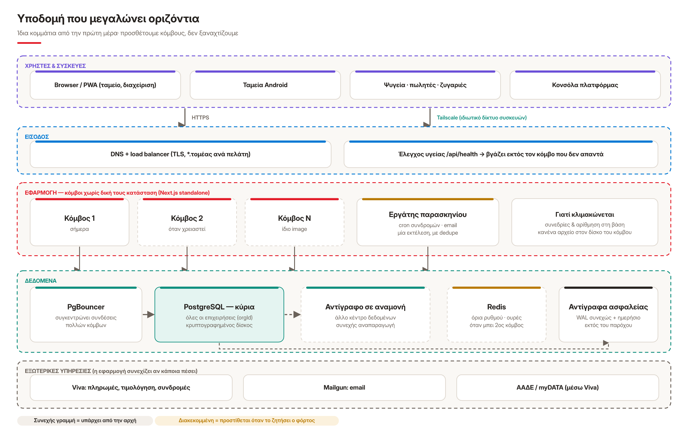
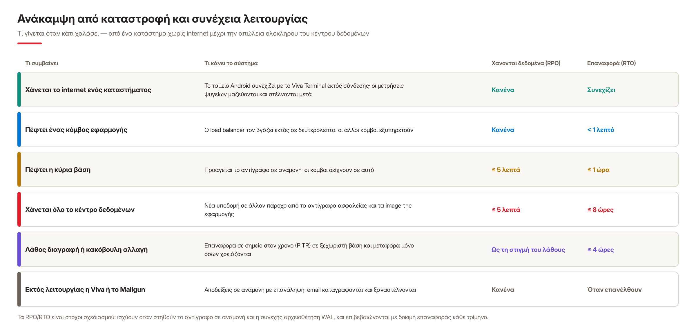

# Υποδομή, ασφάλεια και συνέχεια λειτουργίας — by design

Ημερομηνία: 17/11/2026. Το ίδιο περιεχόμενο, με ζωντανά στοιχεία, υπάρχει μέσα στην εφαρμογή για τον Super Admin: ομάδα μενού «Υποδομή & ασφάλεια» (Υποδομή, Ασφάλεια, Συνέχεια λειτουργίας). Η πηγή του είναι το `web/lib/ops.ts`.

## 1. Οριζόντια ανάπτυξη χωρίς να ξαναχτιστεί τίποτα

Η αρχή: **ίδια κομμάτια από την πρώτη μέρα, σε μικρό μέγεθος**. Όταν μεγαλώσει ο φόρτος προστίθενται μηχανήματα· τίποτα δεν πετιέται.

| Στάδιο | Πότε | Τι προστίθεται |
|---|---|---|
| 1 · Εκκίνηση | Από την πρώτη μέρα | Ένας server με εφαρμογή και PostgreSQL. Αντίγραφα ασφαλείας εκτός server. |
| 2 · Διαχωρισμός | Όταν βάση και εφαρμογή ανταγωνίζονται για πόρους | Η βάση σε δικό της server, με PgBouncer. |
| 3 · Οριζόντια | Όταν ένας κόμβος δεν φτάνει ή θέλουμε ενημερώσεις χωρίς διακοπή | Δεύτερος κόμβος εφαρμογής πίσω από load balancer. Redis. |
| 4 · Ανθεκτικότητα | Όταν μία ώρα διακοπής κοστίζει περισσότερο από έναν server | Αντίγραφο βάσης σε αναμονή σε άλλο κέντρο δεδομένων. |
| 5 · Όγκος | Όταν οι μετρήσεις συσκευών γίνουν εκατοντάδες εκατομμύρια | TimescaleDB για τις μετρήσεις· μεγάλοι πελάτες σε δική τους βάση αν χρειαστεί. |

Δεν δίνω αριθμούς πελατών ανά στάδιο: εξαρτώνται από το πόσες αποδείξεις και μετρήσεις παράγει ο καθένας. Η σελίδα «Υποδομή» δείχνει απόκριση και μέγεθος βάσης, που είναι τα σήματα για το πότε αλλάζει στάδιο.

**Τι κάνει τον κώδικα έτοιμο για πολλούς κόμβους (υπάρχει ήδη):**

- Οι κόμβοι δεν κρατούν κατάσταση: συνεδρίες, αρίθμηση αποδείξεων και σύζευξη συσκευών ζουν στη βάση.
- Η αρίθμηση αποδείξεων κλειδώνει γραμμή στη βάση ανά ταμείο, άρα δύο κόμβοι δεν δίνουν ποτέ τον ίδιο αριθμό.
- `/api/health` για τον load balancer.
- Ένα image (Next.js standalone), ρυθμίσεις μόνο από μεταβλητές περιβάλλοντος.
- Οι προγραμματισμένες εργασίες καλούνται απ' έξω και κάθε email έχει κλειδί μοναδικότητας.

**Τι λείπει:** όρια ρυθμού κοινά σε όλους τους κόμβους (θέλουν Redis) και πίνακας χρονοσειρών για τις μετρήσεις.

## 2. Ασφάλεια

Υπάρχουν 15 από τα 20 μέτρα του σχεδίου. Η πλήρης λίστα, με ένδειξη «υπάρχει / στο σχέδιο», είναι στη σελίδα «Ασφάλεια».

Εκκρεμούν, με σειρά προτεραιότητας:

1. Ιστορικό ενεργειών (ποιος άλλαξε τι, πότε).
2. Δεύτερος παράγοντας (2FA) για το προσωπικό της πλατφόρμας.
3. Όριο προσπαθειών στη σύζευξη συσκευών ανά διεύθυνση.
4. Κρυπτογράφηση δίσκου βάσης και αντιγράφων (ρύθμιση υποδομής).
5. CSP με nonce, χωρίς inline scripts.

## 3. Ανάκαμψη από καταστροφή και συνέχεια λειτουργίας

Τα RPO/RTO είναι **στόχοι σχεδιασμού**, όχι μετρήσεις. Ισχύουν όταν στηθούν το αντίγραφο σε αναμονή και η συνεχής αρχειοθέτηση WAL, και επιβεβαιώνονται με δοκιμή επαναφοράς.

Η σελίδα «Συνέχεια λειτουργίας» κρατά δύο ημερομηνίες και προειδοποιεί όταν παλιώσουν:

- **Έλεγχος αντιγράφων ασφαλείας** — κάθε 7 ημέρες.
- **Δοκιμή επαναφοράς** — κάθε 90 ημέρες.

Και οι δύο είναι σήμερα «δεν έχει γίνει ποτέ», γιατί δεν υπάρχει ακόμα server παραγωγής ούτε αντίγραφα.

## 4. Τι πρέπει να αποφασιστεί

1. Πάροχος και τοποθεσία του πρώτου server, και δεύτερος πάροχος για τα αντίγραφα.
2. Αν το αντίγραφο σε αναμονή στήνεται από την αρχή ή στο στάδιο 4.
3. Ποιος κάνει τον εβδομαδιαίο έλεγχο αντιγράφων και την τριμηνιαία δοκιμή επαναφοράς.
